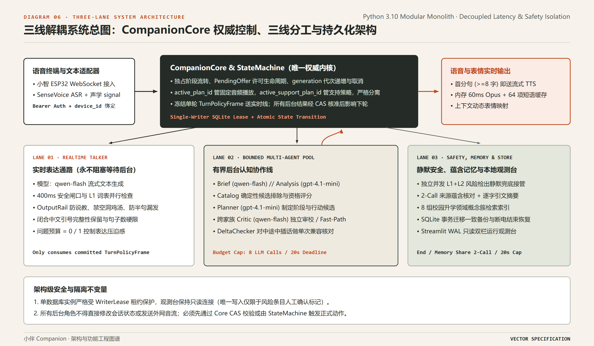

# 情感陪伴玩偶后端：安装、运行与工程维护

本文档提供 **小伴 Companion**（面向中国初高中升学日常压力陪伴的多 Agent 语音与对话系统）的本地安装、CLI/观测台运行、小智端侧联调、验证入口与源码架构导航。

- **项目主页（Markdown）**：[README.md](README.md)
- **在线互动展示站**：<https://hhuang999.github.io/AIAA3800-companion-doll-backend/>
- **在线研究与架构说明书**：<https://hhuang999.github.io/AIAA3800-companion-doll-backend/research-design/>
- **中英双语权威系统规格、BibTeX 与基准图表素材包**：[`companion/docs/reference-pack/README.md`](companion/docs/reference-pack/README.md)
- **本机运行与接手规范**：[`AGENTS.md`](AGENTS.md) · [工程 Review](companion/docs/ENGINEERING_REVIEW.md) · [运行与迁移手册](companion/docs/V2_OPERATIONS.md)

## 系统概况与当前内容配置

本系统为基于 Python 3.10 模块化单体的情感陪伴原型（`companion/companion/`），面向初高中升学日常学业与评价压力场景，课程验证仅使用合成案例或成年成员扮演，不作临床声明。当前默认启用配置（`companion/companion/config/`）：

- **9 张分层支持策略卡**：`concrete_step`、`exam_steadying`、`kind_self_talk`、`comparison_reframe`、`expectation_boundary`、`safe_communication`、`safe_support`、`values_exploration`、`worry_parking`（配合 L1 四态陪伴底座）。
- **3 段 `< 90s` 可随时中断短练习**：`bedtime`（39.0s）、`breathing_60s`（43.5s）、`grounding`（41.7s），共绑定 24 段预合成固定音频资源。
- **19 篇学术与公共卫生文献依据**：完整收录于 `companion/companion/config/content_manifest.yaml` 与 [`references.bib`](companion/docs/reference-pack/references.bib)。
- **研究说明书与视觉图谱**：[`PROJECT_RESEARCH_AND_SYSTEM_DESIGN.md`](companion/docs/research-design/PROJECT_RESEARCH_AND_SYSTEM_DESIGN.md) 配 11 张工程矢量图纸（[`docs/assets/diagrams/`](docs/assets/diagrams/)）与 6 组 AI 概念场景摄影图（[`docs/assets/image-provenance.json`](docs/assets/image-provenance.json)）。

[](https://hhuang999.github.io/AIAA3800-companion-doll-backend/)

## 立即运行

首次使用请先按下方“安装到新环境”建立 `.venv`，并配置 `.env`（`AIHUBMIXKEY`）。随后在仓库根目录打开 PowerShell：

```powershell
# 离线文字对话（使用 FakeLLM，不调用外部 API）
./scripts/run.ps1 fake --db data/development.db

# 在线文字对话（读取 .env 中的 AIHUBMIXKEY）
./scripts/run.ps1 live --db data/development.db

# 在另一终端启动本地 WAL 只读双栏运行观测台（http://127.0.0.1:8501）
./scripts/run.ps1 dashboard --db data/development.db
```

命令行支持 `/policy`（查看当前与当轮策略）、`/memory`（查询范围与来源记忆）、`/jobs`（查看后台认知任务及 Critic 评审）、`/state`（查看状态机阶段）、`/wait`（等待后台分析完成）、`/cry 今天很难过`（模拟哭声信号）、`/emotion SAD 今天很累`（传入情绪标识）、`/end`（触发结束整理）与 `/quit`（退出）。输入“怎么办”会先在 `permission` 阶段发出单步邀请，仅在明确同意且存在合格策略卡时进入 `action`；练习可通过 `--realtime` 在终端观察停顿节奏，真实音频播报由小智适配器承担：

```powershell
./scripts/run.ps1 fake --realtime
./scripts/run.ps1 fake --scenario companion/tests/scenarios/08_permission.yaml
```

## 安装到新环境

需预装 Python 3.10 与 `uv`。Windows 环境下可执行：

```powershell
./scripts/setup.ps1
# 也可显式指定已有 Python 3.10 解释器路径
./scripts/setup.ps1 -Python C:/path/to/python.exe
```

跨平台等价安装方式：

```sh
uv venv --python 3.10 .venv
uv pip install --python .venv/bin/python -r companion/requirements.lock
uv pip install --python .venv/bin/python --no-deps -e companion
```

Windows 下解释器路径为 `.venv/Scripts/python.exe`；锁文件基于 Windows + Python 3.10 环境生成。参考 `.env.example` 创建本地 `.env`（进程环境变量优先于 `.env`）；源码、配置与数据库均不会持久化明文 key。

## 验证与实测基准

统一离线门禁与最新实测汇总见 [双语系统规格与实测手册](companion/docs/reference-pack/SYSTEM_SPEC_AND_BENCHMARKS_ZH.md) 与 [`companion/docs/evidence/course-2.0-bench.json`](companion/docs/evidence/course-2.0-bench.json)（2026-11-21）：

- **2026-11-21 基准实测**（`course-2.0-bench.json`）：22 段多轮合成回放全通过（0 超时，后台认知 P50 `5889.1 ms` / P90 `7389.3 ms`）；30 次在线流式文本首token P50 `1016.0 ms` / 首句 P50 `1109.5 ms`；30 次小智 WebSocket 环回 Opus 语音客户端首包 P50 `2656.0 ms`（P90 `3140.0 ms`，0 失败）。
- **2026-11-09 安全与蕴含记忆核验**：[`online-regression-20261109.json`](companion/docs/evidence/online-regression-20261109.json)（120 条人工编制风险语料高风险/关注召回 `1.0`、高风险误报 `0.0`）与 [`grounded-memory-20261109.json`](companion/docs/evidence/grounded-memory-20261109.json)（8 组抽取 + 6/6 反事实蕴含核对）。
- **2026-11-04 早期基线归档**：保留于 [VALIDATION.md](companion/docs/VALIDATION.md) 与 [V2_IMPLEMENTATION_STATUS.md](companion/docs/V2_IMPLEMENTATION_STATUS.md) 作为历史对比对照，不与当前 2026-11-21 数据混用。

```powershell
# Ruff 静态检查、格式检查与全部离线 pytest（不访问外部网络）
./scripts/run.ps1 test

# 显式运行在线回归与 120 条风险分类验收（消耗 API 额度）
.venv/Scripts/python.exe -m pytest companion/tests -m online --basetemp artifacts/pytest-online-manual

# 30 次文本延迟探针
.venv/Scripts/python.exe -m companion.tools.bench --env-file .env --count 30 --output artifacts/latency.json

# 生成并校验 3 段短练习固定音频
./scripts/run.ps1 audio
```

## 配置、持久化与数据清理

默认配置位于 `companion/companion/config/`，可通过 `--config-dir` 指定部署副本：

| 文件 | 用途 |
| --- | --- |
| `settings.yaml` | 模型分配、预算上限、超时、线程池、数据库与 TTS |
| `persona.yaml` / `stages.yaml` | 身份设定、开场/重连、收尾与邀请模板 |
| `rules.yaml` / `risk_lexicon.yaml` | 口语否定前瞻同意/拒绝规则、输出护栏与 L1 词表 |
| `cards/*.yaml` / `content_manifest.yaml` | 9 张策略卡协议、19 篇来源核查与准入摘要 |
| `crisis.yaml` | 固定危机接管话术与审核信息 |
| `exercises/*.yaml` | 3 段短练习文本、句后停顿与固定音频索引 |
| `prompts/*.j2` | Talker、Risk 与后台 7 角色 Jinja2 提示词模板 |

默认数据库为 `data/companion.db`；SQLite Schema 当前为 `user_version=2`，支持一致备份下的 `v1 -> v2` 事务迁移（详见 [V2_OPERATIONS.md](companion/docs/V2_OPERATIONS.md)）。同一数据库由单一 `WriterLease` 进程持有；中断未完成会话在重启后转为结束整理任务，已标记 `failed` 的结束任务可在停服后重试：

```powershell
.venv/Scripts/python.exe -m companion.tools.retry_end <session_id> --env-file .env --db data/companion.db
.venv/Scripts/python.exe -m companion.tools.purge cli-local --db data/companion.db
```

运行中服务调用 `CompanionCore.purge_user(user_key)` 会先取消并等待后台任务落盘后再清理；备份或删库须覆盖 `.db` 主文件及 `-wal` / `-shm` 附属文件。

## 接入小智（ESP32 语音网关）

接入补丁维护于 [`xiaozhi_patch/README.md`](xiaozhi_patch/README.md)，锁定上游提交 `92337881a7b6553614b47e137a774d02bf40512f`。6 处鉴权与流式协议补丁通过 `xiaozhi_patch/apply.py` 检查与应用，详细协议见 [小智交接包](companion/docs/XIAOZHI_HANDOFF.md)：

```powershell
./scripts/setup_xiaozhi.ps1   # 首次安装小智独立 venv 与运行环境
./scripts/run_xiaozhi.ps1     # 启动小智 WebSocket 服务（ws://127.0.0.1:8000/xiaozhi/v1/）
./scripts/run.ps1 dashboard --db data/xiaozhi.db
```

## 源码导航

- `companion/companion/core/`：`CompanionCore`（`api.py`）、单步许可状态机（`state_machine.py`）、`Talker` 分句与 `OutputRail`（`talker.py`）、静默安全分类（`risk.py`）、策略校验（`validator.py`）。
- `companion/companion/cognition/`：公平调度、自适应快路径（`fast_path_non_action`）、跨家族独立 `Critic`、`DeltaChecker`、四重版本号 CAS 与局部边界判定（`policy.py`）。
- `companion/companion/content/`：策略资格过滤、内容准入回执与固定音频清单绑定。
- `companion/companion/memory/` 与 `store/`：四类记忆、`ConsolidationGrounder` 来源蕴含核对、8 组中文概念簇索引（`concepts.py`）、SQLite 单写者租约与事务迁移。
- `companion/companion/adapters/` 与 `dashboard/`：CLI、离线剧本、小智 WebSocket + 内存 60ms Opus + 64 项 LRU 输出适配器、Streamlit 只读观测台。

实现决策归档见 [DECISIONS.md](companion/docs/DECISIONS.md)，内容准入见 [CONTENT.md](companion/docs/CONTENT.md)。
