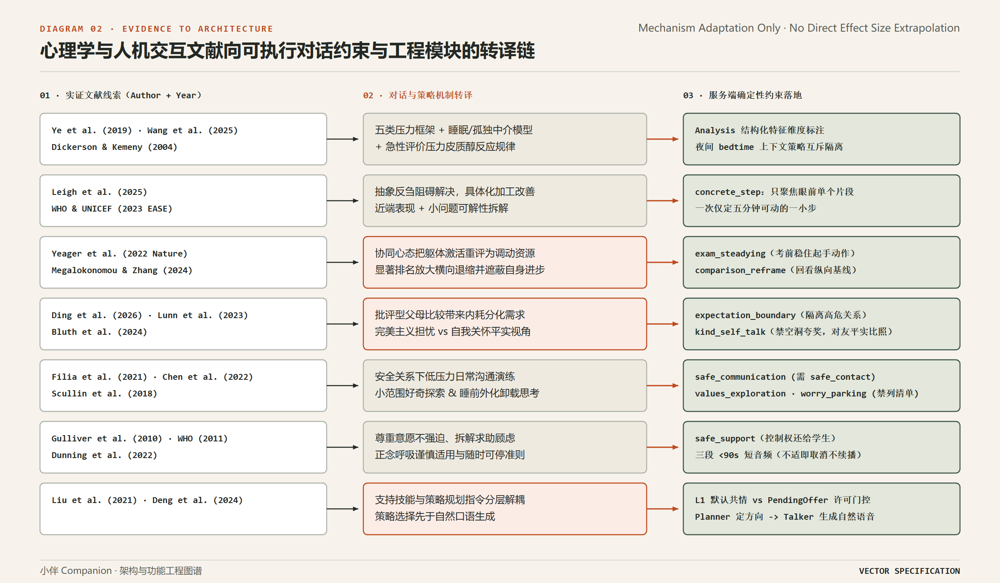
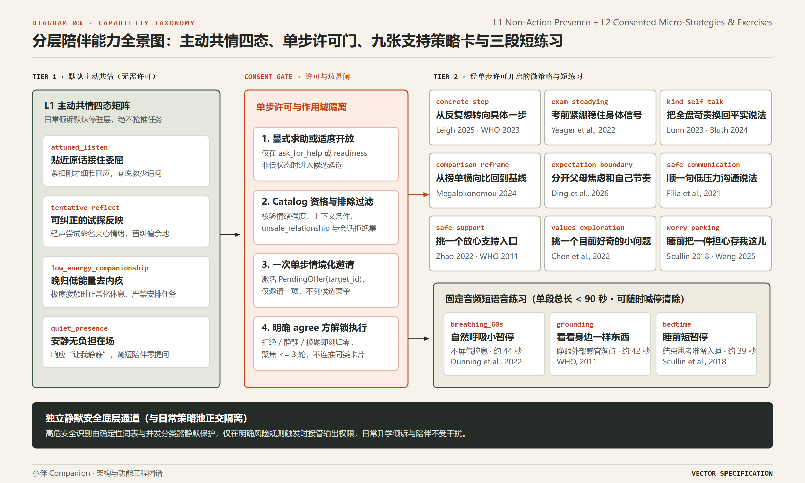
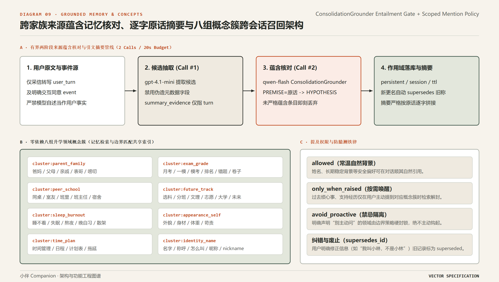

# 小伴 Companion：面向中国初高中升学压力的日常情感陪伴智能体

[](https://hhuang999.github.io/AIAA3800-companion-doll-backend/)
[](https://hhuang999.github.io/AIAA3800-companion-doll-backend/research-design/)
[](ENGINEERING.md)

**小伴 Companion** 是一个面向承受中考与高考日常学业及评价压力的中国初高中学生的桌面情感陪伴智能体与后端系统。面对学生深夜放学后的吐槽与卡壳，系统围绕一句核心交互准则构建：**共情陪伴默认在场；任何小步建议与呼吸练习必须经学生单步许可才进入；拒绝不讲道理，疲惫时不布置任务，跨会话记忆只保留经用户原文严格蕴含核对的事实与边界。**

- **在线互动展示主页**：<https://hhuang999.github.io/AIAA3800-companion-doll-backend/>
- **完整研究与系统架构说明书（网页版）**：<https://hhuang999.github.io/AIAA3800-companion-doll-backend/research-design/>
- **说明书 Markdown 源文件**：[`PROJECT_RESEARCH_AND_SYSTEM_DESIGN.md`](companion/docs/research-design/PROJECT_RESEARCH_AND_SYSTEM_DESIGN.md) · **工程运行入口**：[`ENGINEERING.md`](ENGINEERING.md)

<p align="center">
  
</p>

---

## 摘要与核心设计理念

夜晚十点半下晚自习回到房间，学生叹一口气，往往并不缺一份“学习规划教程”。通用对话模型在此类日常倾诉中常见三类失配：**听见半句委屈便抢着开出 1-2-3 改进清单；依赖粗粒度关键词封锁误伤合理讨论；以及把模型安慰揣测错记成用户长期偏好。**

为解决“语音必须实时响应，但策略选择需要深思熟虑且绝对受用户边界约束”之间的张力，后端构建为 Python 3.10 模块化单体并实行**三线严格解耦**：
1. **实时表达线（Talker Lane）**：严格消费当前已生效策略帧发声，绝不阻塞等待后台思考；首个 `>= 8` 字自然语义切片即送流式 Opus 合成并在纯内存中完成 60ms 打包；
2. **有界后台协作线（Bounded Cognition Lane）**：并行运行独立盲审简报与情境分析，经策略目录确定性筛选后由规划与跨家族审校协同制定候选方案，日常纯共情倾诉直走快路径免去冗余评审；
3. **静默安全与来源蕴含记忆线（Safety, Grounded Memory & CAS）**：独立风险安全层在后台静默兜底而不抢夺日常主线；会话记忆与逐字摘要在两步有界预算内执行前提蕴含核对，再借助八组校园升学领域概念簇与四重版本号 CAS 事务控制写入 SQLite。

<p align="center">
  <a href="docs/assets/companion-desk-scale.webp"></a><br>
  <sub>概念形态与实体尺度示意：约 22cm 暖白奶油短密羊毛桌面伙伴，无屏幕、无按钮与指示灯（点击查看大图）</sub>
</p>

---

## 1. 场景洞察：中国初高中升学日常压力与支持需求

“想到考试就心慌”背后往往混杂着完全不同的现场处境——一道题连续卡壳、月考红榜发布后不敢看同桌进度、被父母拿亲戚排名比较但暂不想争吵，或下晚自习精疲力竭却因为停下歇十分钟而自责内疚。

系统依据中学生日常压力与求助特征文献，将情境归约为**五类可并发叠加的压力维度**（学业负担、社会评价、家庭与同伴关系、未来选科迷茫、自我苛责）与**四条心理放大通路**（抽象反刍、过度自我批评、睡眠扰动、孤立扛压）。同时针对青少年普遍存在的**怕被评判说教、顾虑隐私面子、怕给忙碌家人添乱**三类求助障碍（*Zhao & Hu, 2022*; *Gulliver et al., 2010*），以无屏幕低打扰的桌面短语音形态降低表达防备，配合服务端确定性状态控制把自主掌控权交还学生。


---

## 2. 研究转译：心理学与 HCI 文献向工程约束的映射

系统参考了 19 项经核对的青少年压力心理学与可控对话系统研究（文末附录列出完整标准参考文献与 DOI/链接），并不直接宣称继承临床疗程效应量，而是严格转译为具体的策略机理、情境适用条件、禁用边界与模块分工约束：



- **压力结构与睡前隔离**（*Ye et al., 2019*; *Wang et al., 2025*; *Dickerson & Kemeny, 2004*）：建模多维并列压力与睡眠孤独中介通路，明确禁止在睡前开启高负荷多步骤任务引导。
- **考前生理激活协同重评**（*Yeager et al., 2022*）：将进考场前心跳飙升、手心出汗重评为身体调动可用注意资源而非垮掉前兆。
- **排名效应与父母比较分化**（*Megalokonomou & Zhang, 2024*; *Ding et al., 2026*）：区分榜单横向攀比窒息感（拉回个人纵向基线）与批评式家庭期待比较（理清大人的焦急与今晚自身节奏，高危关系严格排除）。
- **具体拆步、温和自我关怀与安全连接**（*Leigh et al., 2025*; *WHO & UNICEF, 2023*; *Lunn et al., 2023*; *Bluth et al., 2024*; *Filia et al., 2021*; *Chen et al., 2022*; *Scullin et al., 2018*; *WHO, 2011*; *Dunning et al., 2022*）：仅围绕单一片段或五分钟微行动展开；正念练习严格限时 `< 90s` 并备有睁眼外部定位替代。
- **策略规划与语音生成解耦**（*Liu et al., 2021*; *Deng et al., 2024*）：确立 L1 无许可默认倾听与 L2 许可门控微策略之间的硬隔离。

---

## 3. 核心功能体系与显式同意机制



### 3.1 L1 主动共情四态矩阵（默认无需许可）

当学生未明确求助、处于极度疲惫低准备度或直接拒绝建议时，系统始终驻留于 L1 非行动共情层：

| L1 目标姿态 (`objective`) | 适用情境 | 对话行为约束 |
| --- | --- | --- |
| `attuned_listen` | 刚倾诉具体委屈，或明确表达“只聊聊不想要办法” | 紧贴刚才听到的具体细节接住感受，少反问、零说教 |
| `tentative_reflect` | 话里有矛盾感、欲言又止或未挑明的夹心情绪 | 用可被轻松纠正的试探口气轻声反映感受（如“听起来像是……”） |
| `low_energy_companionship` | 晚自习归来极度疲惫（`readiness=low`）或休息时怀有负罪感 | 正常化极度疲劳、明确去内疚，**严禁**布置任何学习任务 |
| `quiet_presence` | 学生要求“让我静静”或夜间收尾 | 一句简短确认自己在场陪伴，零追问、零建议 |

### 3.2 L2 九张支持策略卡（单步 `PendingOffer` 许可后最多三轮）


策略目录中的每张卡在 `YAML` 协议中显式定义触发靶点、`when_any` / `not_when`、单步邀请语、三步口语结构及刚性禁语（`never_say`）。目录前置过滤通过且经学生口语或明确点头同意后，每次仅聚焦一张卡：

1. **`concrete_step`（从反复想转向具体的一步）**：针对学业反复空转（*Leigh et al., 2025*; *WHO & UNICEF, 2023*），承接已说出片段缩出一个五分钟可起头的小事，疲惫或纯倾诉禁用。
2. **`exam_steadying`（考前紧绷稳住身体信号）**：针对模考与考前心跳手抖（*Yeager et al., 2022*; *Dickerson & Kemeny, 2004*），用协同心态正常化生理激活并定开考第一步，严重惊恐切回 L1/着陆，禁用“肯定能考好”。
3. **`kind_self_talk`（把全盘苛责换回平实的说法）**：面向一次考砸即否定整个人（*Lunn et al., 2023*; *Bluth et al., 2024*），借对待好朋友标准改出贴合事实一句，遇校园欺凌绝不归因个人想法，禁空洞鸡汤。
4. **`comparison_reframe`（从榜单横向比回到自己的基线）**：针对成绩榜与同伴内卷掉队感（*Megalokonomou & Zhang, 2024*; *Dickerson & Kemeny, 2004*），回看自身两周具体小变化而不否认升学竞争。
5. **`expectation_boundary`（把父母的焦虑和自己节奏分开）**：针对父母拿分数与亲戚比较而暂不愿冲突（*Ding et al., 2026*; *Dickerson & Kemeny, 2004*），划清家长焦急与个人今晚步调；`unsafe_relationship` 严禁启用并禁止输出“父母都是为你好”。
6. **`safe_communication`（顺一句低压力的沟通说法）**：仅在确认 `safe_contact` 且不含安全威胁与睡前场景时（*Filia et al., 2021*; *Gulliver et al., 2010*），拟一句日常口语备用，决定权留给学生。
7. **`safe_support`（挑一个让你放心的现实支持入口）**：针对孤立硬扛与求助障碍（*Zhao & Hu, 2022*; *Gulliver et al., 2010*; *WHO, 2011*），公开拆解面子与保密顾虑，禁做独占暗示或强迫倾诉。
8. **`values_exploration`（挑一个目前好奇的方向小问题）**：针对选科分班与意义迷茫（*Chen et al., 2022*; *Ye et al., 2019*），缩成可查证的小好奇点，严禁做专业算命或政策保证，**睡前及拒建议边界严格禁用**。
9. **`worry_parking`（睡前把一件担心先存我这儿）**：仅限睡前 `bedtime`（*Scullin et al., 2018*; *Wang et al., 2025*），外化封存一句明早担心并温和道晚安，严禁趁机拉计划清单。

### 3.3 三段固定音频短练习与确定性许可状态机


- **三段短语音练习（单段总长均控制于 `< 90 秒`）**：`breathing_60s`（自然呼吸小暂停 · 约 44s，*Dunning et al., 2022*，不适躯体焦点禁用）、`grounding`（看看身边的一样东西 · 约 42s，*WHO, 2011*，借日常物外部定位）与 `bedtime`（睡前短暂停 · 约 39s，*Scullin et al., 2018*）。
- **显式单步许可与即时停用**：`rules.yaml` 支持自然口语 `agree` 且用否定前瞻防误触；学生拒听、喊停或夜间退出时立即清空 `resume_script_id` 记入拒绝集合（不会误入等待续播），仅中性外界噪音打断保留重评询问；重连 `wake` 先检索历史发言跳过冗余开场。

---

## 4. 系统架构与有界多 Agent 后台协作


- **唯一权威核心**：`CompanionCore` 与 `StateMachine` 独占阶段流转、`PendingOffer` 许可态及代次递增取消权。任何后台角色绝不越过核心直接开关行动或外放语音。
- **有界多 Agent 协作与快慢分流**（见下图）：后台以 `8 LLM Calls / 20s` 封顶并行运行盲审 `Brief`（`qwen-flash`）与结构化 `Analysis`（`gpt-4.1-mini`）；`Catalog` 确定性剔除不符合语境或已拒绝项；`Planner`（`gpt-4.1-mini`）产成候选后，若属纯倾听无行动且不覆盖活跃邀约（`not protects_active_offer`）则直接通过自适应 **`fast_path_non_action`** 直达发布检查；凡携行动邀请或存在边界疑问，一律交跨家族 **`Critic`**（`qwen-flash`）独立核准，遏制单模型确认偏误。


---

## 5. 跨会话来源蕴含记忆与作用域边界隔离



- **两阶段有界蕴含核对（`2 Calls / 20s`）**：记忆提取与会话收尾总结共用预算——首步由 `gpt-4.1-mini` 从已落库真实 `user_turn` 与交互事件抽提候选及 `summary_evidence`（仅允许 `turn_id` 指针，服务端按原话逐字拼接摘要）；次步交由跨家族 `ConsolidationGrounder`（`qwen-flash`）逐句检验 `PREMISE(原话) -> HYPOTHESIS`，拦截无端揣测，同时支持“我是小琳”纠正旧昵称并置为 `superseded`。
- **八组升学领域概念簇与局部边界隔离**：内置 `parent_family`、`exam_grade`、`peer_school`、`future_track`、`sleep_burnout`、`appearance_self`、`time_plan` 与 `identity_name` 概念索引。配合负向瞻前边界正则，既可跨会话精确唤醒 `only_when_raised` 的更名与历史经历，又确保“以后别问数学成绩”不会误伤夜间情绪疏导，同时放行“不想定死未来，想看看选科手册”。

---

## 6. 并发执行控制与实时语音流水线


- **四重版本号 CAS 与增量兼容性**：新说话立刻递增 `generation` 并作废在途播报；`active_plan_id`（音频练习队列）与 `active_support_plan_id`（策略方向）寿命严格分离。后台结果出版前先经 `DeltaChecker` 在 `120 秒 / 4 轮` 有效窗内校验中途新发言，再在 SQLite 事务锁内严格核对 `topic_revision`、`policy_revision`、`boundary_revision` 与 `base_plan_version` 四项完全相等方可激活；过期方案放弃时已核对记忆仍支持部分提交，且崩溃重启可安全恢复未完结收尾。
- **实时分句与内存 Opus 流管线**（见下图）：`Talker` 对首个 `>= 8` 字自然切片连带闭合中文引号送入流式 TTS（同步并行运行 400ms 安全闸与 `OutputRail`），命中 64 项短语 LRU `PacketCache` 时直接吐帧，未命中则由 `gpt-4o-mini-tts` 直接流式输出 `opus` 并经 `PyAV` + `opuslib_next` 纯内存打包为 60ms 帧送达小智端，彻底省去磁盘临时 WAV 往返。


---

## 7. 三个典型交互过程走查


1. **父母比较压力与单步许可进入**：倾诉被拿表哥比排名后，先发出 `expectation_boundary` 情境邀请，经学生口语“行吧，那你讲讲”同意方展开第一步自身节奏梳理。
2. **晚归疲惫与随时喊停**：十点半放学拒绝对策走 `low_energy_companionship` + `fast_path_non_action` 去内疚，追说“让我静静”时 `generation` 递增立刻清空续问进入 `quiet_presence`。
3. **跨会话更名与作用域隔离**：更名“小琳（王字旁）”与禁问成绩边界分别经过蕴含校验持久化；重连跳过多余引导且用 `identity_name` 精准复述称呼，同时丝滑支持睡前 `worry_parking`。

### 典型日常与交互概念场景（点击查看高清图）

<table>
  <tr>
    <td width="33%" align="center">
      <a href="docs/assets/companion-study-night.webp"></a><br>
      <strong>晚自习归来书桌陪伴</strong><br>
      <sub>暖黄台灯下低负担在场，不催促刷题</sub>
    </td>
    <td width="33%" align="center">
      <a href="docs/assets/companion-wake-gesture.webp"></a><br>
      <strong>轻触唤醒与随时喊停</strong><br>
      <sub>伸手轻拍触发或暂停，交互控制权归学生</sub>
    </td>
    <td width="33%" align="center">
      <a href="docs/assets/companion-bedtime.webp"></a><br>
      <strong>睡前床头微光在场</strong><br>
      <sub>无屏幕光打扰，仅作睡前卸载与晚安收尾</sub>
    </td>
  </tr>
</table>

---

## 8. 附录：目录索引、本地运行与参考文献

### 仓库核心目录与工程图谱索引

| 目录 / 模块 | 职责说明 |
| --- | --- |
| `companion/companion/core/` | `CompanionCore` 状态核、`StateMachine`、单步许可 `PendingOffer`、`helpers.py`、`Talker`、`OutputRail` 与静默安全门 `risk.py` |
| `companion/companion/cognition/` | `Scheduler` 公平调度、`Orchestrator` 快慢通路与 CAS 发布、`Brief`/`Analysis`/`Planner`/`Critic`/`DeltaChecker`、`policy.py` |
| `companion/companion/memory/` · `store/` | 八组概念簇（`concepts.py`）、`ConsolidationGrounder` 来源蕴含核对、SQLite `WriterLease` 单写者与事务迁移 |
| `companion/companion/content/` · `config/` | 九张策略卡与三段短练习 YAML、提示词模板 `.j2`、内容目录与固定音频配置清单 |
| `companion/companion/adapters/` · `dashboard/` | 小智 WebSocket/Opus 内存适配器、命令行交互与 WAL 只读双栏运行观测台（`app.py`） |
| `xiaozhi_patch/` · `scripts/` · `docs/` | 小智上游固定提交 `92337881` 端侧补丁、站点数据导出脚本 `build_project_site.py`、静态展示站与 11 张工程矢量图纸 `docs/assets/diagrams/` |

### 本地运行入口（Windows PowerShell）

环境安装与硬件对接详情参见 [`ENGINEERING.md`](ENGINEERING.md)、[`V2_OPERATIONS.md`](companion/docs/V2_OPERATIONS.md) 与 [`XIAOZHI_HANDOFF.md`](companion/docs/XIAOZHI_HANDOFF.md)：

```powershell
# 1. 初始化本地 Python 3.10 .venv 环境
./scripts/setup.ps1

# 2. 启动离线合成剧本对话、真实模型对话（需在 .env 配好 AIHUBMIXKEY）或本地只读运行观测台
./scripts/run.ps1 fake --db data/development.db
./scripts/run.ps1 live --db data/development.db
./scripts/run.ps1 dashboard --db data/development.db

# 3. 合成固定音频脚本并从指定提交树导出站点数据
.venv/Scripts/python.exe -m companion.tools.upgrade_config data/xiaozhi-config
.venv/Scripts/python.exe -m companion.tools.prepare_audio --env-file .env --config-dir data/xiaozhi-config --output data/fixed_audio --bind-config
.venv/Scripts/python.exe scripts/build_project_site.py --revision HEAD
```

### 学术与公共卫生参考文献

1. Bluth, K., Lathren, C., Park, H., et al. (2024). *Feasibility, Acceptability, and Depression Outcomes of a Randomized Controlled Trial of Mindful Self-Compassion for Teens*. Journal of Adolescence. DOI: `10.1002/jad.12277`. [PDF](https://self-compassion.org/wp-content/uploads/2024/06/Bluth2024.pdf)
2. Chen, H., Chen, X., Ling, C., & Gu, J. (2022). *An Online Career Intervention for Promoting Chinese High School Students’ Career Readiness*. Frontiers in Psychology. DOI: `10.3389/fpsyg.2021.815076`. [PMC](https://pmc.ncbi.nlm.nih.gov/articles/PMC8784529/)
3. Deng, Y., Zhang, W., Lam, W., Ng, S. K., & Chua, T.-S. (2024). *Plug-and-Play Policy Planner for Large Language Model Powered Dialogue Agents*. ICLR 2024. [PDF](https://openreview.net/pdf?id=MCNqgUFTHI)
4. Dickerson, S. S., & Kemeny, M. E. (2004). *Acute stressors and cortisol responses: A theoretical integration and synthesis of laboratory research*. Psychological Bulletin, 130(3), 355–391. DOI: `10.1037/0033-2909.130.3.355`. [PubMed](https://pubmed.ncbi.nlm.nih.gov/15122924/)
5. Ding, N., Yin, Z., Li, Q., & Zhou, H. (2026). *Types of parental social comparison and links with adolescent psychological outcomes*. Journal of Research on Adolescence, 36(2), e70216. DOI: `10.1111/jora.70216`. [Publisher](https://doi.org/10.1111/jora.70216)
6. Dunning, D., Tudor, K., Radley, L., et al. (2022). *Do mindfulness-based programmes improve the cognitive skills, behaviour and mental health of children and adolescents? An updated meta-analysis of randomised controlled trials*. Evidence-Based Mental Health. [PMC](https://pmc.ncbi.nlm.nih.gov/articles/PMC9340039/)
7. Filia, K., Eastwood, O., Herniman, S., & Badcock, P. (2021). *Facilitating improvements in young people’s social relationships to prevent or treat depression: A review of empirically supported interventions*. Translational Psychiatry. DOI: `10.1038/s41398-021-01406-7`. [PDF](https://www.nature.com/articles/s41398-021-01406-7.pdf)
8. Gulliver, A., Griffiths, K. M., & Christensen, H. (2010). *Perceived barriers and facilitators to mental health help-seeking in young people: a systematic review*. BMC Psychiatry, 10, 113. DOI: `10.1186/1471-244X-10-113`. [PMC](https://pmc.ncbi.nlm.nih.gov/articles/PMC3022639/)
9. Leigh, E., Taylor, C., Cole, R., & Smith, P. (2025). *Why is rumination unhelpful in adolescents? Two studies examining the causal role of abstract processing*. Journal of Affective Disorders. DOI: `10.1016/j.jad.2025.03.058`. [ORA](https://ora.ox.ac.uk/objects/uuid%3A1bfdd831-ddfe-4efb-9dab-7b802d9ff8af/files/rrj430622m)
10. Liu, S., Zheng, C., Demasi, O., et al. (2021). *Towards Emotional Support Dialog Systems*. ACL 2021. DOI: `10.18653/v1/2021.acl-long.269`. [ACL Anthology](https://aclanthology.org/2021.acl-long.269/)
11. Lunn, J., Greene, D., Callaghan, T., & Egan, S. J. (2023). *Associations between perfectionism and symptoms of anxiety, obsessive-compulsive disorder and depression in young people: A meta-analysis*. Cognitive Behaviour Therapy. DOI: `10.1080/16506073.2023.2211736`. [PubMed](https://pubmed.ncbi.nlm.nih.gov/37194469/)
12. Megalokonomou, R., & Zhang, Y. (2024). *How good am I? Effects and mechanisms behind salient rank*. European Economic Review, 170, 104870. DOI: `10.1016/j.euroecorev.2024.104870`. [Publisher](https://doi.org/10.1016/j.euroecorev.2024.104870)
13. Scullin, M. K., Krueger, M. L., Ballard, H. K., Pruett, N., & Bliwise, D. L. (2018). *The effects of bedtime writing on difficulty falling asleep: A polysomnographic study comparing to-do lists and completed activity lists*. Journal of Experimental Psychology: General, 147(1), 139–146. DOI: `10.1037/xge0000374`. [PubMed](https://pubmed.ncbi.nlm.nih.gov/29058942/)
14. Wang, X., Wang, L., Yang, M., et al. (2025). *Academic Burden and Emotional Problems Among Adolescents: A Longitudinal Mediation Analysis*. Journal of Adolescence. DOI: `10.1002/jad.12471`. [Wiley](https://onlinelibrary.wiley.com/doi/10.1002/jad.12471)
15. World Health Organization (WHO), War Trauma Foundation & World Vision International. (2011). *Psychological first aid: Guide for field workers*. Geneva: WHO. [PDF](https://iris.who.int/bitstream/handle/10665/44615/9789241548205_eng.pdf?sequence=1)
16. World Health Organization (WHO) & UNICEF. (2023). *Early Adolescent Skills for Emotions (EASE): Group psychological help for young adolescents affected by distress*. Geneva: WHO. [PDF](https://iris.who.int/bitstream/handle/10665/374996/9789240082755-eng.pdf)
17. Ye, L., Cui, Z., Yang, R., & Liu, J. (2019). *Evaluation of the Factor Structure of the Adolescent Stress Questionnaire in Chinese Adolescents*. Psychological Reports, 122(6), 2366–2384. DOI: `10.1177/0033294118792686`. [PMC](https://pmc.ncbi.nlm.nih.gov/articles/PMC6669116/)
18. Yeager, D. S., Bryan, C. J., Gross, J. J., et al. (2022). *A synergistic mindsets intervention protects adolescents from stress*. Nature, 607, 512–520. DOI: `10.1038/s41586-022-04907-7`. [Nature](https://www.nature.com/articles/s41586-022-04907-7)
19. Zhao, Y., & Hu, B. (2022). *A multilevel model of the help-seeking behaviors among adolescents with mental health problems*. Frontiers in Integrative Neuroscience, 16, 946842. DOI: `10.3389/fnint.2022.946842`. [PMC](https://pmc.ncbi.nlm.nih.gov/articles/PMC9478167/)

---

## Scope & Ethics

本系统为 HKUST(GZ) AIAA 3800 课程研发的初高中日常情感陪伴与减压原型，定位为非医疗、非诊断性的同龄感支持工具。后台独立风险分类仅作日常交互保护兜底，不构成临床心理评估、危机干预认证或升学政策推荐保证。公开仓库与站点仅包含合成案例、策略协议、工程架构规格及开源学术文献列表，绝不包含设备令牌、API 密钥或真实学生对话记录。全套概念玩偶场景图由模型创作并仅用作桌面质感与交互概念示意，具体工业外观及真实量产传感器尚在硬件课程设计探索中。
