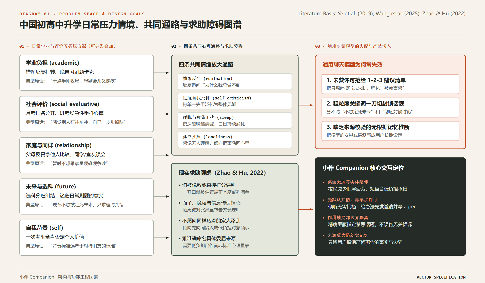
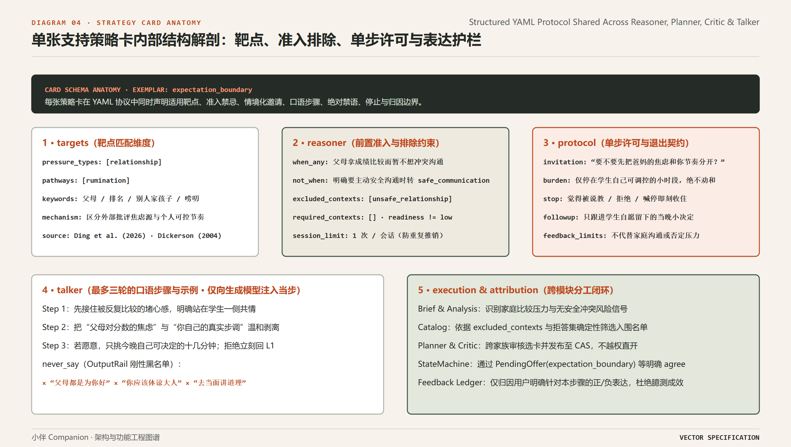
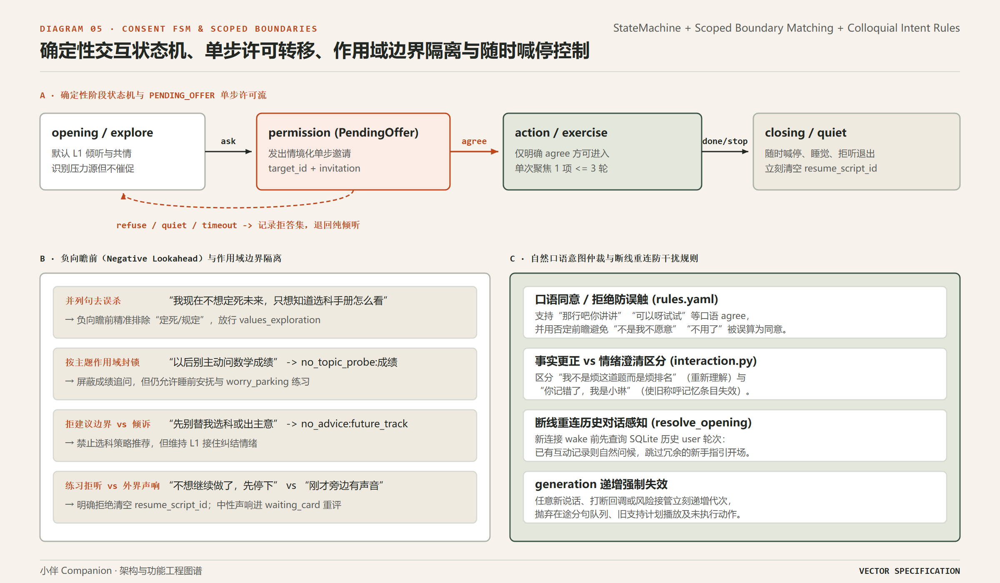
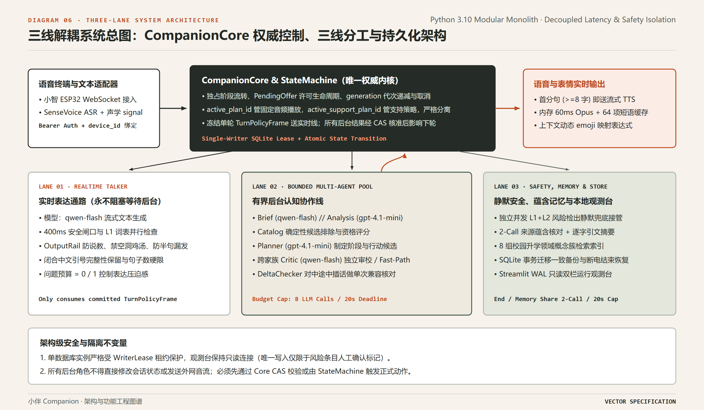
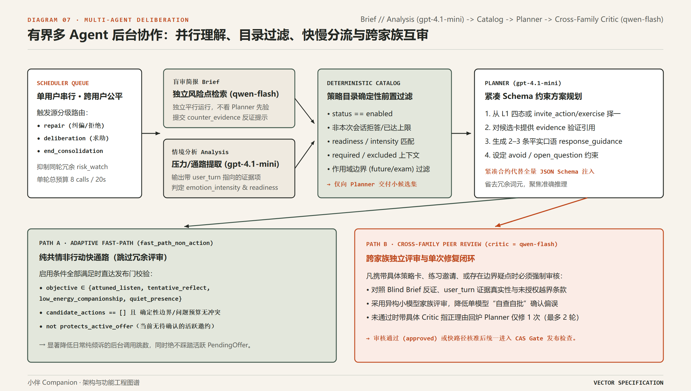
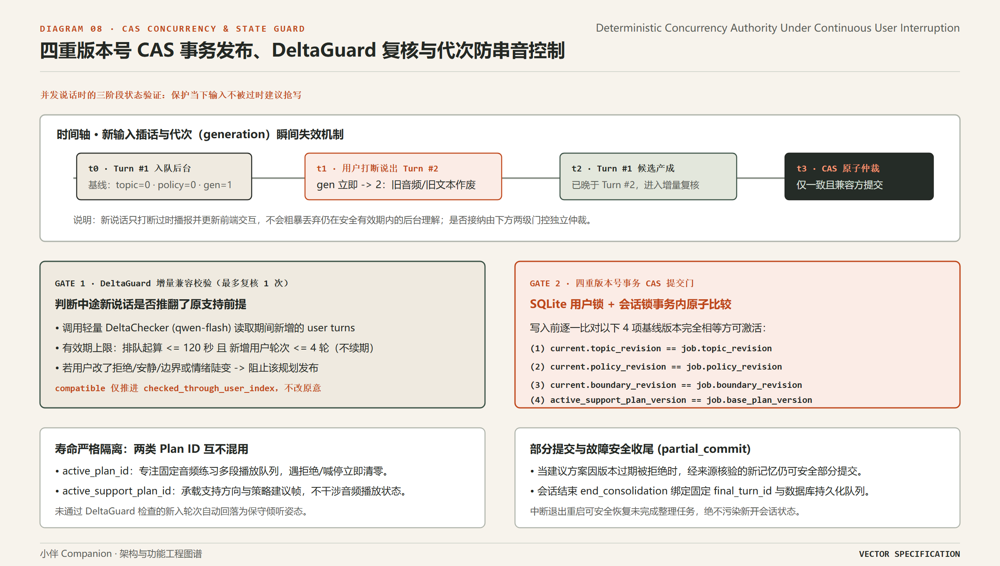
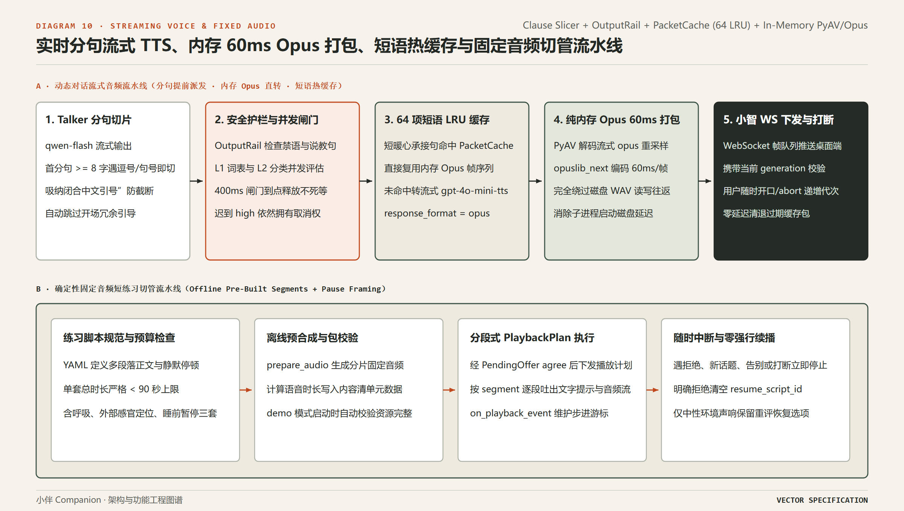
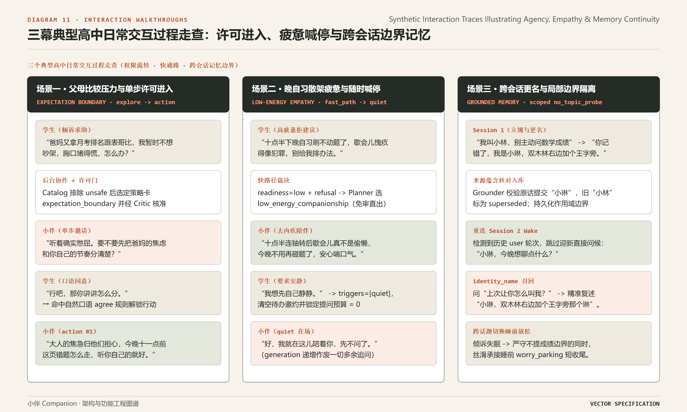

<div align="center">

<h1>小伴 Companion</h1>
<p><strong>面向中国初高中升学压力的日常情感陪伴智能体与确定性多 Agent 后端</strong></p>

<p>
  <a href="https://hhuang999.github.io/AIAA3800-companion-doll-backend/"></a>
  <a href="https://hhuang999.github.io/AIAA3800-companion-doll-backend/research-design/"></a>
  <a href="ENGINEERING.md"></a>
</p>

<p>
  <a href="https://hhuang999.github.io/AIAA3800-companion-doll-backend/"><strong>在线互动展示站</strong></a> ·
  <a href="https://hhuang999.github.io/AIAA3800-companion-doll-backend/research-design/"><strong>研究与架构说明书（网页版）</strong></a> ·
  <a href="companion/docs/research-design/PROJECT_RESEARCH_AND_SYSTEM_DESIGN.md"><strong>说明书 Markdown</strong></a> ·
  <a href="ENGINEERING.md"><strong>工程启动入口</strong></a>
</p>

<a href="docs/assets/companion-daylight.webp">
  
</a>

</div>

---

## 核心设计主张与实体在场

> [!NOTE]
> **核心交互铁律**：共情倾听默认在场；任何小步建议与短练习必须经学生情境化单步许可才进入；拒绝不讲道理，疲惫时不布置任务；跨会话记忆只保留经用户原文严格蕴含核对的事实与局部边界。

夜晚十点半下晚自习回到房间，学生叹一口气，往往并不缺一份“学习规划教程”。通用对话模型在此类日常倾诉中常见三类失配：**听见半句委屈便抢着输出 1-2-3 改进清单；依赖粗粒度关键词一刀切屏蔽合理讨论；以及把模型自身揣测悄无声息写进长期用户记忆。**

围绕“语音必须实时呼吸、策略必须深思且绝对尊重学生边界”的张力，后端基于 Python 3.10 与小智 ESP32 端协议构建模块化单体并严格实行**三线解耦**：

1. **实时表达线（Talker Lane）**：严格消费当前已生效策略帧发声，绝不等待后台推理；首个 `>= 8` 字自然意群连带闭合引号即送流式 Opus 合成并在纯内存中完成 `60 ms` 打包。
2. **有界后台协作线（Bounded Cognition Lane）**：`Brief // Analysis` 并行理解，经 `Catalog` 确定性筛选后由 `Planner` 制定方案；日常纯倾诉直走自适应快路径，携带行动邀请或边界疑点时必经跨家族 `Critic` 把关。
3. **静默安全与蕴含记忆线（Safety, Grounded Memory & CAS）**：独立安全层静默兜底而不抢占日常主线；会话记忆与逐字摘要在两步有界预算内执行前提蕴含核对，再借助八组升学域概念簇与四重版本号 CAS 写入 SQLite。

<p align="center">
  <a href="docs/assets/companion-desk-scale.webp">
    
  </a>
</p>

### 典型日常与交互概念场景

<table align="center">
  <tr>
    <td width="50%" align="center" valign="top">
      <a href="docs/assets/companion-study-night.webp">
        
      </a><br>
      <strong>晚自习归来 · 低负担书桌陪伴</strong><br>
      <sub>暖黄台灯下静坐桌角，先接住精疲力竭，绝不趁疲惫加塞任务清单</sub>
    </td>
    <td width="50%" align="center" valign="top">
      <a href="docs/assets/companion-wake-gesture.webp">
        
      </a><br>
      <strong>轻触唤醒与随时喊停 · 交互控制权在手</strong><br>
      <sub>伸手轻拍或一句话喊停立即递增 <code>generation</code> 作废在途语音输出</sub>
    </td>
  </tr>
  <tr>
    <td width="50%" align="center" valign="top">
      <a href="docs/assets/companion-bedtime.webp">
        
      </a><br>
      <strong>睡前床头微光 · 认知卸载与夜间收尾</strong><br>
      <sub>零屏幕蓝光与指示灯打扰，仅作一句话封存明早惦记与温和道晚安</sub>
    </td>
    <td width="50%" align="center" valign="top">
      <a href="docs/assets/companion-touch.webp">
        
      </a><br>
      <strong>来源蕴含记忆 · 平等非独占守则</strong><br>
      <sub>只记住原话明确支持过的偏好与局部边界，不制造依恋、不强迫倾诉</sub>
    </td>
  </tr>
</table>

---

## 1. 场景洞察：中国初高中升学日常压力与支持需求

“想到考试就心慌”背后往往混杂着完全不同的现场处境——一道题连续卡壳、月考红榜公布后不敢看同桌进度、被父母拿亲戚排名比较但暂不想争吵，或下晚自习累散了架却因为停下歇十分钟而自责。

系统基于青少年压力实证研究，将现场归约为**五类可并发叠加的压力维度**（学业负担、社会评价、家庭与同伴关系、未来选科迷茫、自我苛责）与**四条心理放大通路**（抽象反刍、过度自我批评、睡眠扰动、孤立扛压），并直面学生“怕被说教、顾虑面子隐私、怕给忙碌家人添负担”三项求助阻力（*Zhao & Hu, 2022*; *Gulliver et al., 2010*）。



---

## 2. 研究转译：心理学与 HCI 文献向工程约束的映射

项目汇集 19 项青少年压力心理学与可控对话系统研究（文末附录列出完整标准文献与 DOI 链接），将其严格转译为策略机理、触发边界与模块硬约束：


| 核心研究线索 | 心理学与人机交互发现 | 落地后的系统规则与策略 |
| --- | --- | --- |
| *Ye et al. (2019)*；*Wang et al. (2025)*；*Dickerson & Kemeny (2004)* | 中国中学生压力呈多维交织；睡眠障碍与孤独承担统计中介作用；不可控社会评价显著拉升急性应激唤醒 | 五维并列压力与四条通路标注；夜间严禁诱导多步骤长规划 |
| *Yeager et al. (2022)*；*Leigh et al. (2025)*；*WHO & UNICEF (2023)* | 协同心态重评考前激活信号；具体化加工显著优于抽象泛化反刍 | `exam_steadying` 与 `concrete_step`，聚焦眼下五分钟可起头微步 |
| *Megalokonomou & Zhang (2024)*；*Ding et al. (2026)* | 高可见度横向排名加剧掉队退缩；父母批评比较诱发温和边界冲突 | `comparison_reframe` 与 `expectation_boundary`（高危关系严格禁用） |
| *Lunn et al. (2023)*；*Bluth et al. (2024)*；*Chen et al. (2022)* | 区分高标准与自我苛责完美主义；高一低负担生涯探索促进准备度 | `kind_self_talk` 好友视角改写与 `values_exploration`（睡前禁开） |
| *Scullin et al. (2018)*；*Dunning et al. (2022)*；*Liu et al. (2021)*；*Deng et al. (2024)* | 睡前简短外化卸载减轻唤醒；正念须提供外部替代与停下权利；策略规划与语音生成分离 | `worry_parking`、`< 90s` 固定短练与 L1/L2 硬分层状态控制 |

---

## 3. 分层陪伴体系与 L1 无许可共情矩阵

> [!TIP]
> **L1 默认无需许可 vs. L2 单步 `PendingOffer`**：未收到清晰求助、高疲惫低准备度（`readiness=low`）或被学生拒绝后，系统自动驻留于 L1；任何行动建议或音频练习必须先经过一次单步许可邀请并由 `StateMachine` 独占放行。

| L1 目标姿态 (`objective`) | 典型适用处境 | 口语与行为硬约束 |
| --- | --- | --- |
| **`attuned_listen`** | 刚倾诉具体委屈，或明确要求“只聊聊不想要办法” | 紧贴刚才听到的具体细节接住情绪，少反问、零说教 |
| **`tentative_reflect`** | 表达中流露矛盾感、欲言又止或双层夹心情绪 | 以容易被学生推翻纠正的试探口气轻声反映感受 |
| **`low_energy_companionship`** | 晚自习归来极度疲惫（`readiness=low`）或对休息怀有内疚 | 正常化极度疲劳、明确去内疚，**严禁**布置任何学习任务 |
| **`quiet_presence`** | 学生主动说出“让我静静”或夜间收尾 | 一句简短确认在场，提问预算锁为 `0` |

<details>
<summary><strong>展开查看：全部 9 张 L2 支持策略卡、3 段固定短练习与 3 张策略/状态机图谱（Fig 03–05）</strong></summary>

<br>


### L2 九张支持策略卡（`PendingOffer` 许可后最多三轮）

1. **`concrete_step`（从反复想转向具体的一步）**：针对学业反复空转（*Leigh et al., 2025*; *WHO & UNICEF, 2023*），承接已说出片段缩出一个五分钟可起头的小事，疲惫或纯倾诉禁用。
2. **`exam_steadying`（考前紧绷稳住身体信号）**：针对模考与考前心跳手抖（*Yeager et al., 2022*; *Dickerson & Kemeny, 2004*），正常化生理激活并定开考第一步，严重惊恐切回 L1/着陆，禁用“肯定能考好”。
3. **`kind_self_talk`（把全盘苛责换回平实的说法）**：面向一次考砸即否定整个人（*Lunn et al., 2023*; *Bluth et al., 2024*），借对待好朋友标准改出贴合事实一句，遇校园欺凌绝不归因个人想法，禁空洞鸡汤。
4. **`comparison_reframe`（从榜单横向比回到自己的基线）**：针对成绩榜与同伴内卷掉队感（*Megalokonomou & Zhang, 2024*; *Dickerson & Kemeny, 2004*），回看自身两周具体小变化而不否认升学竞争。
5. **`expectation_boundary`（把父母的焦虑和自己节奏分开）**：针对父母拿分数与亲戚比较而暂不愿冲突（*Ding et al., 2026*; *Dickerson & Kemeny, 2004*），划清家长焦急与个人今晚步调；`unsafe_relationship` 严禁启用并禁止输出“父母都是为你好”。
6. **`safe_communication`（顺一句低压力的沟通说法）**：仅在确认 `safe_contact` 且不含安全威胁与睡前场景时（*Filia et al., 2021*; *Gulliver et al., 2010*），拟一句日常口语备用，决定权留给学生。
7. **`safe_support`（挑一个让你放心的现实支持入口）**：针对孤立硬扛与求助障碍（*Zhao & Hu, 2022*; *Gulliver et al., 2010*; *WHO, 2011*），公开拆解面子与保密顾虑，禁做独占暗示或强迫倾诉。
8. **`values_exploration`（挑一个目前好奇的方向小问题）**：针对新高考选科犹豫与意义迷茫（*Chen et al., 2022*; *Ye et al., 2019*），缩成可查证的小好奇点，严禁算命式断语，**睡前及拒建议边界严格禁用**。
9. **`worry_parking`（睡前把一件担心先存我这儿）**：仅限睡前 `bedtime`（*Scullin et al., 2018*; *Wang et al., 2025*），外化封存一句明早担心并温和道晚安，严禁展开任务清单。



### 三段 `< 90s` 短语音练习与确定性许可状态机

- `breathing_60s`（自然呼吸小暂停 · 约 44 秒，*Dunning et al., 2022*，不适躯体焦点禁用）、`grounding`（看看身边的一样东西 · 约 42 秒，*WHO, 2011*，借桌面物品外部定位）与 `bedtime`（睡前短暂停 · 约 39 秒，*Scullin et al., 2018*）。
- `rules.yaml` 结合负向瞻前解析自然口语 `agree`；任意拒听或“让我静静”立即清空 `resume_script_id` 记入拒绝集合，重连 `wake` 先检索历史发言跳过冗余新手开场。



</details>

---

## 4. 三线解耦架构与有界多 Agent 协作

`CompanionCore` 与 `StateMachine` 独占阶段流转、`PendingOffer` 许可态及代次递增取消权。后台以 `8 LLM Calls / 20s` 封顶并行运行盲审 `Brief`（`qwen-flash`）与结构化 `Analysis`（`gpt-4.1-mini`）；`Catalog` 确定性剔除违规或不合语境卡片后，`Planner` 在纯粹倾听且不覆盖活跃邀约（`not protects_active_offer`）时直走 `fast_path_non_action`，携行动邀请或边界疑问时必经跨家族 `Critic`（`qwen-flash`）把关。





---

## 5. 跨会话来源蕴含记忆与并发控制管线

- **来源蕴含记忆与八组概念簇**：共用 `2 Calls / 20s` 预算——首步从真实 `user_turn` 与同意记录抽出候选及原话 `summary_evidence`；次步由跨家族 `ConsolidationGrounder` 逐句检验前提蕴含拦截揣测，支持更名废止（`superseded`），并依托 `parent_family`、`exam_grade`、`identity_name` 等八组升学概念簇搭配负向瞻前实现精准唤醒与局部禁忌隔离。
- **四重版本号 CAS 与纯内存 Opus 流**：`DeltaChecker` 在 `120s / 4 轮` 内校验插话兼容性，锁内严格比对 `(topic_revision, policy_revision, boundary_revision, base_plan_version)` 四项一致方激活下轮策略（过期时已核对记忆支持部分提交）；`Talker` 对首个 `>= 8` 字语义切片连带闭合引号即送流式 TTS，配合 64 项短语热缓存、`400ms` 并行安全门与 `PyAV` + `opuslib_next` 纯内存 `60ms` Opus 打包零磁盘落盘。


<details>
<summary><strong>展开查看：CAS 并发控制与流式 Opus 音频流水线图谱及三幕交互走查（Fig 08, 10, 11）</strong></summary>

<br>





1. **父母比较压力与单步许可进入**：抱怨父母拿表哥比排名后先发出 `expectation_boundary` 情境邀请，经学生口语同意方展开第一步自身节奏梳理。
2. **晚归疲惫与随时喊停**：十点半拒绝对策走 `low_energy_companionship` + `fast_path_non_action` 去内疚，追说“让我静静”时递增 `generation` 立刻清空续问进入 `quiet_presence`。
3. **跨会话更名与作用域隔离**：更名“小琳（王字旁）”与禁问成绩边界经蕴含校验落库；重连跳过多余开场并经 `identity_name` 精准复述称呼，同时顺畅支持睡前 `worry_parking`。



</details>

---

## 6. 仓库导航、本地启动与标准文献附录

<details>
<summary><strong>仓库代码模块与全套 11 张矢量图谱直接索引（PNG / SVG）</strong></summary>

<br>

| 目录 / 模块 | 职责说明 |
| --- | --- |
| [`companion/companion/core/`](companion/companion/core/) | `CompanionCore` 状态核、`StateMachine`、单步许可 `PendingOffer`、`helpers.py`、`Talker`、`OutputRail` 与静默安全门 `risk.py` |
| [`companion/companion/cognition/`](companion/companion/cognition/) | `Scheduler` 公平调度、`Orchestrator` 快慢通路与 CAS 发布、`Brief`/`Analysis`/`Planner`/`Critic`/`DeltaChecker`、`policy.py` |
| [`companion/companion/memory/`](companion/companion/memory/) · [`store/`](companion/companion/store/) | 八组概念簇（`concepts.py`）、`ConsolidationGrounder` 来源蕴含核对、SQLite `WriterLease` 单写者与事务迁移 |
| [`companion/companion/content/`](companion/companion/content/) · [`config/`](companion/companion/config/) | 九张策略卡与三段短练习 YAML、提示词模板 `.j2`、内容目录与固定音频配置清单 |
| [`companion/companion/adapters/`](companion/companion/adapters/) · [`dashboard/`](companion/companion/dashboard/) | 小智 WebSocket/Opus 内存适配器、命令行交互与 WAL 只读双栏运行观测台（`app.py`） |
| [`xiaozhi_patch/`](xiaozhi_patch/) · [`scripts/`](scripts/) · [`docs/`](docs/) | 小智上游固定提交 `92337881` 端侧补丁、站点数据导出脚本 `build_project_site.py`、静态展示站与 [`docs/README.md`](docs/README.md) 视觉资产索引 |

| 序号 | 图谱主题 | 位图预览 (`@2x PNG`) | 无损矢量 (`SVG`) |
| --- | --- | --- | --- |
| 01 | 升学日常压力情境、放大通路与求助障碍 | [PNG](docs/assets/diagrams/01-context-and-stressors.png) | [SVG](docs/assets/diagrams/01-context-and-stressors.svg) |
| 02 | 心理学与人机交互文献向工程约束转译链 | [PNG](docs/assets/diagrams/02-evidence-to-design.png) | [SVG](docs/assets/diagrams/02-evidence-to-design.svg) |
| 03 | L1 四态、单步许可门与九卡三练分层全景 | [PNG](docs/assets/diagrams/03-strategy-taxonomy.png) | [SVG](docs/assets/diagrams/03-strategy-taxonomy.svg) |
| 04 | 单张支持策略卡内部协议字段解剖 | [PNG](docs/assets/diagrams/04-strategy-card-anatomy.png) | [SVG](docs/assets/diagrams/04-strategy-card-anatomy.svg) |
| 05 | 确定性交互状态机、局部边界与喊停控制 | [PNG](docs/assets/diagrams/05-consent-boundary-fsm.png) | [SVG](docs/assets/diagrams/05-consent-boundary-fsm.svg) |
| 06 | 三线解耦系统总图与权威控制架构 | [PNG](docs/assets/diagrams/06-system-architecture.png) | [SVG](docs/assets/diagrams/06-system-architecture.svg) |
| 07 | 有界多 Agent 后台协作与快慢路径分流 | [PNG](docs/assets/diagrams/07-multiagent-deliberation.png) | [SVG](docs/assets/diagrams/07-multiagent-deliberation.svg) |
| 08 | 四重版本号 CAS 事务发布与代次并发控制 | [PNG](docs/assets/diagrams/08-cas-concurrency.png) | [SVG](docs/assets/diagrams/08-cas-concurrency.svg) |
| 09 | 跨家族来源蕴含记忆核对与八组概念簇召回 | [PNG](docs/assets/diagrams/09-grounded-memory.png) | [SVG](docs/assets/diagrams/09-grounded-memory.svg) |
| 10 | 实时分句流式 TTS 与内存 60ms Opus 流水线 | [PNG](docs/assets/diagrams/10-voice-opus-pipeline.png) | [SVG](docs/assets/diagrams/10-voice-opus-pipeline.svg) |
| 11 | 三幕典型初高中日常备考交互过程走查 | [PNG](docs/assets/diagrams/11-interaction-walkthroughs.png) | [SVG](docs/assets/diagrams/11-interaction-walkthroughs.svg) |

</details>

<details>
<summary><strong>Windows PowerShell 本地运行与站点导出命令</strong></summary>

<br>

环境与硬件部署详情参见 [`ENGINEERING.md`](ENGINEERING.md)、[`V2_OPERATIONS.md`](companion/docs/V2_OPERATIONS.md) 与 [`XIAOZHI_HANDOFF.md`](companion/docs/XIAOZHI_HANDOFF.md)：

```powershell
# 1. 初始化本地 Python 3.10 .venv 运行环境
./scripts/setup.ps1

# 2. 启动离线合成剧本对话、真实模型对话（需在 .env 配好 AIHUBMIXKEY）或本地只读运行观测台
./scripts/run.ps1 fake --db data/development.db
./scripts/run.ps1 live --db data/development.db
./scripts/run.ps1 dashboard --db data/development.db

# 3. 合成固定音频脚本并从指定提交树导出站点数据
.venv/Scripts/python.exe -m companion.tools.upgrade_config data/xiaozhi-config
.venv/Scripts/python.exe -m companion.tools.prepare_audio --env-file .env --config-dir data/xiaozhi-config --output data/fixed_audio --bind-config
.venv/Scripts/python.exe scripts/build_project_site.py --revision HEAD
```

</details>

<details>
<summary><strong>完整学术与公共卫生参考文献（19 项经核对文献）</strong></summary>

<br>

1. Bluth, K., Lathren, C., Park, H., et al. (2024). *Feasibility, Acceptability, and Depression Outcomes of a Randomized Controlled Trial of Mindful Self-Compassion for Teens*. Journal of Adolescence. DOI: `10.1002/jad.12277`. [PDF](https://self-compassion.org/wp-content/uploads/2024/06/Bluth2024.pdf)
2. Chen, H., Chen, X., Ling, C., & Gu, J. (2022). *An Online Career Intervention for Promoting Chinese High School Students’ Career Readiness*. Frontiers in Psychology. DOI: `10.3389/fpsyg.2021.815076`. [PMC](https://pmc.ncbi.nlm.nih.gov/articles/PMC8784529/)
3. Deng, Y., Zhang, W., Lam, W., Ng, S. K., & Chua, T.-S. (2024). *Plug-and-Play Policy Planner for Large Language Model Powered Dialogue Agents*. ICLR 2024. [PDF](https://openreview.net/pdf?id=MCNqgUFTHI)
4. Dickerson, S. S., & Kemeny, M. E. (2004). *Acute stressors and cortisol responses: A theoretical integration and synthesis of laboratory research*. Psychological Bulletin, 130(3), 355–391. DOI: `10.1037/0033-2909.130.3.355`. [PubMed](https://pubmed.ncbi.nlm.nih.gov/15122924/)
5. Ding, N., Yin, Z., Li, Q., & Zhou, H. (2026). *Types of parental social comparison and links with adolescent psychological outcomes*. Journal of Research on Adolescence, 36(2), e70216. DOI: `10.1111/jora.70216`. [Publisher](https://doi.org/10.1111/jora.70216)
6. Dunning, D., Tudor, K., Radley, L., et al. (2022). *Do mindfulness-based programmes improve the cognitive skills, behaviour and mental health of children and adolescents? An updated meta-analysis of randomised controlled trials*. Evidence-Based Mental Health. [PMC](https://pmc.ncbi.nlm.nih.gov/articles/PMC9340039/)
7. Filia, K., Eastwood, O., Herniman, S., & Badcock, P. (2021). *Facilitating improvements in young people’s social relationships to prevent or treat depression: A review of empirically supported interventions*. Translational Psychiatry. DOI: `10.1038/s41398-021-01406-7`. [PDF](https://www.nature.com/articles/s41398-021-01406-7.pdf)
8. Gulliver, A., Griffiths, K. M., & Christensen, H. (2010). *Perceived barriers and facilitators to mental health help-seeking in young people: a systematic review*. BMC Psychiatry, 10, 113. DOI: `10.1186/1471-244X-10-113`. [PMC](https://pmc.ncbi.nlm.nih.gov/articles/PMC3022639/)
9. Leigh, E., Taylor, C., Cole, R., & Smith, P. (2025). *Why is rumination unhelpful in adolescents? Two studies examining the causal role of abstract processing*. Journal of Affective Disorders. DOI: `10.1016/j.jad.2025.03.058`. [ORA](https://ora.ox.ac.uk/objects/uuid%3A1bfdd831-ddfe-4efb-9dab-7b802d9ff8af/files/rrj430622m)
10. Liu, S., Zheng, C., Demasi, O., et al. (2021). *Towards Emotional Support Dialog Systems*. ACL 2021. DOI: `10.18653/v1/2021.acl-long.269`. [ACL Anthology](https://aclanthology.org/2021.acl-long.269/)
11. Lunn, J., Greene, D., Callaghan, T., & Egan, S. J. (2023). *Associations between perfectionism and symptoms of anxiety, obsessive-compulsive disorder and depression in young people: A meta-analysis*. Cognitive Behaviour Therapy. DOI: `10.1080/16506073.2023.2211736`. [PubMed](https://pubmed.ncbi.nlm.nih.gov/37194469/)
12. Megalokonomou, R., & Zhang, Y. (2024). *How good am I? Effects and mechanisms behind salient rank*. European Economic Review, 170, 104870. DOI: `10.1016/j.euroecorev.2024.104870`. [Publisher](https://doi.org/10.1016/j.euroecorev.2024.104870)
13. Scullin, M. K., Krueger, M. L., Ballard, H. K., Pruett, N., & Bliwise, D. L. (2018). *The effects of bedtime writing on difficulty falling asleep: A polysomnographic study comparing to-do lists and completed activity lists*. Journal of Experimental Psychology: General, 147(1), 139–146. DOI: `10.1037/xge0000374`. [PubMed](https://pubmed.ncbi.nlm.nih.gov/29058942/)
14. Wang, X., Wang, L., Yang, M., et al. (2025). *Academic Burden and Emotional Problems Among Adolescents: A Longitudinal Mediation Analysis*. Journal of Adolescence. DOI: `10.1002/jad.12471`. [Wiley](https://onlinelibrary.wiley.com/doi/10.1002/jad.12471)
15. World Health Organization (WHO), War Trauma Foundation & World Vision International. (2011). *Psychological first aid: Guide for field workers*. Geneva: WHO. [PDF](https://iris.who.int/bitstream/handle/10665/44615/9789241548205_eng.pdf?sequence=1)
16. World Health Organization (WHO) & UNICEF. (2023). *Early Adolescent Skills for Emotions (EASE): Group psychological help for young adolescents affected by distress*. Geneva: WHO. [PDF](https://iris.who.int/bitstream/handle/10665/374996/9789240082755-eng.pdf)
17. Ye, L., Cui, Z., Yang, R., & Liu, J. (2019). *Evaluation of the Factor Structure of the Adolescent Stress Questionnaire in Chinese Adolescents*. Psychological Reports, 122(6), 2366–2384. DOI: `10.1177/0033294118792686`. [PMC](https://pmc.ncbi.nlm.nih.gov/articles/PMC6669116/)
18. Yeager, D. S., Bryan, C. J., Gross, J. J., et al. (2022). *A synergistic mindsets intervention protects adolescents from stress*. Nature, 607, 512–520. DOI: `10.1038/s41586-022-04907-7`. [Nature](https://www.nature.com/articles/s41586-022-04907-7)
19. Zhao, Y., & Hu, B. (2022). *A multilevel model of the help-seeking behaviors among adolescents with mental health problems*. Frontiers in Integrative Neuroscience, 16, 946842. DOI: `10.3389/fnint.2022.946842`. [PMC](https://pmc.ncbi.nlm.nih.gov/articles/PMC9478167/)

</details>

---

## Scope & Ethics

本系统为 HKUST(GZ) AIAA 3800 课程研发的初高中日常情感陪伴与减压原型，定位为非医疗、非诊断性的同龄感支持工具。后台独立风险分类仅作日常交互保护兜底，不构成临床心理评估、危机干预认证或升学政策推荐保证。公开仓库与站点仅包含合成案例、策略协议、工程架构规格及开源学术文献列表，绝不包含设备令牌、API 密钥或真实学生对话记录。全套概念玩偶场景图由模型创作并仅用作桌面质感与交互概念示意，具体工业外观及真实量产传感器尚在硬件课程设计探索中。
