# 小伴 Companion：面向中国初高中升学压力的日常情感陪伴智能体研究与系统设计

**目标受众**：面临中考与高考日常学业及评价压力的中国初高中学生  
**在线互动主页**：<https://hhuang999.github.io/AIAA3800-companion-doll-backend/> · **源码仓库**：<https://github.com/hhuang999/AIAA3800-companion-doll-backend> · **工程入口**：[ENGINEERING.md](../../../ENGINEERING.md)

---

## 摘要与核心设计理念

夜晚十点半下晚自习回到房间，许多初高中生面对未写完的错题、刚公布的月考名次或父母的反复比较，往往并不缺一份“学习规划教程”。恰恰相反，传统对话模型在这一场景里最容易踩中三类失配：**听见半句叹气便抢着输出“1、2、3 条建议清单”；靠粗糙关键词一刀切屏蔽合理探讨；或者把模型自身的安慰揣测悄无声息地写进长期用户记忆。**

**小伴 Companion** 是基于 Python 3.10 与小智 ESP32 桌面端接入构建的无屏幕桌面情感陪伴智能体原型。本系统的核心设计取舍只有一句：**把“无条件共情陪伴”与“经学生明确许可后才进入微策略小步骤”严格拆开，并让确定性状态机而非生成式文本掌握阶段切换、单步许可与即时喊停的绝对权威。**

围绕这一目标，系统在架构上采用**三线解耦设计**：
1. **实时表达线（Talker Lane）**：严格消费已生效策略帧流式发声，在首个超过 8 个有效字符的自然意群处即送流式 Opus 合成并在纯内存中完成 60ms 打包，兼顾安全闸门与闭合引号保护；
2. **有界后台协作线（Bounded Cognition Lane）**：并行运行独立盲审简报与情境分析，经策略目录前置过滤后由跨家族规划与审校模型形成候选方案，日常纯共情倾诉直走快路径免去冗余评议，携行动或边界疑点时必经跨家族把关；
3. **静默安全与来源蕴含记忆线（Safety, Grounded Memory & CAS）**：独立安全层静默保护底线而不抢夺日常主线；会话记忆与逐字摘要在两步有界预算内执行整句前提蕴含核对，再借助八组校园升学领域概念簇与四重版本号 CAS 事务控制写入 SQLite。


---

## 1. 场景洞察：中国初高中升学日常压力与支持需求

### 1.1 五类并发压力源与“只想聊聊”到“求个微步”的动态切换

“想到下周模考就胸口发紧”看似是同一句情绪吐槽，背后可能对应截然不同的当下需求：可能是刚在数学压轴题卡壳两个小时，可能是月考红榜发布后不敢看同桌的刷题进度，也可能是晚自习回家后被父母拿亲戚成绩对比、此刻只想静静喘口气。因此，系统不能按固定心理量表逐题审问，更不能把任意怨言直接当成“解决问题”的指令。

结合中国中学生日常压力文献与现场求助特征，我们将核心情景抽象为**五类可并发叠加的日常压力维度**（学业负担 `academic`、社会评价 `social_evaluative`、家庭与同伴关系 `relationship`、未来与选科迷茫 `future`、自我苛责 `self`），以及**四条跨情景的心理放大通路**：

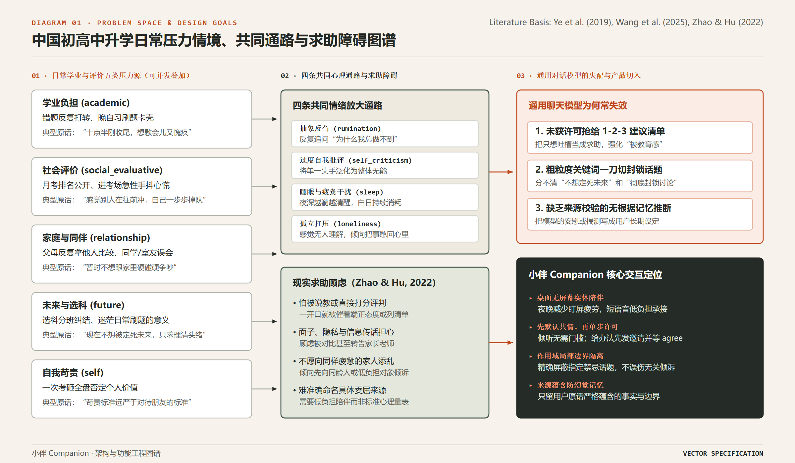

- **抽象反刍（rumination）**：思维在“为什么我总是做不好”的笼统追问中空转，迟迟落不到一个可控切口；
- **过度自我批评（self_criticism）**：将单次失误直接上升为对个人整体能力的严厉否定；
- **睡眠与疲惫扰动（sleep）**：白天负荷过重延续至睡前躺下时思维过载，次日清醒时倦怠与恢复感失衡；
- **孤立扛压（loneliness）**：顾虑身边大人立刻讲大道理，又怕暴露脆弱或传话泄露而独自闷扛。

### 1.2 青少年求助顾虑与桌面实体交互定位

针对中学生求助行为的研究提示，大多数学生并非毫无倾诉愿望，而是卡在**怕被评判说教、顾虑隐私面子与怕给忙碌家长添负担**三道现实障碍之间（*Zhao & Hu, 2022*; *Gulliver et al., 2010*）。无屏幕、触感柔和的桌面语音陪伴实体将对话从亮着刺眼信息流的手机屏幕剥离出来，降低长段打字负担与“面对大人汇报”的防守心。同时，硬件物理在场感只有配合严格不越界的后台对话治理——**先听懂、再轻声确认、随时可喊停**——才能让这种低负担开放不变成另一种压力来源。


---

## 2. 研究转译：心理学与人机交互文献如何落地为系统约束

文献综述在本项目中并不充当装饰性引文，也不直接外推原临床小组疗程的疗效幅度，而是作为**对话边界、机制隐喻与策略准入排除条件**的直接来源，共对应 19 项经核对的学术与公共卫生参考文献。

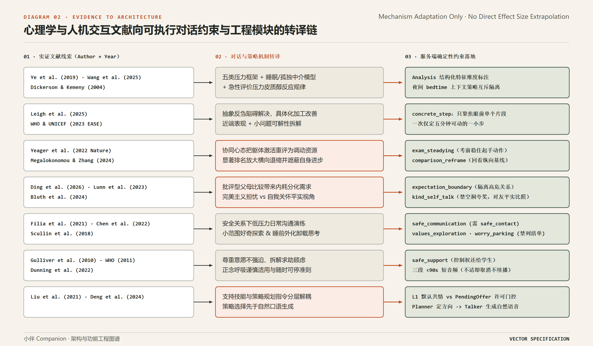

| 核心研究线索（标准作者与年份） | 提炼的关键发现与心理机制 | 转译后的系统规则与策略实现 |
| --- | --- | --- |
| *Ye et al. (2019)*；*Wang et al. (2025)*；*Dickerson & Kemeny (2004)* | 中国中学生压力呈多因子交织；睡眠障碍与孤独在学业负担和情绪困扰间起显著统计中介作用；不可控社会评价显著升高急性生理唤醒 | 建立五维并列压力与四条通路特征标注；睡前时段强约束，严禁睡前诱导多步骤长规划 |
| *Leigh et al. (2025)*；*WHO & UNICEF (2023)* | 具体化加工相比抽象反刍伴随更佳的问题解决与更低负面反扑；结构化问题管理首先筛选小而可解的切入点 | `concrete_step`：不重写全部历史，只切出眼前最卡的一个小片段并定五分钟可动一步 |
| *Yeager et al. (2022)* | 协同心态介入将考前心跳、手汗重评为身体调动可用资源的激活信号，与成长视角协同抵抗急性压力 | `exam_steadying`：不喊“肯定能考好”，帮助把紧绷生理信号正常化并定出开考起手小动作 |
| *Megalokonomou & Zhang (2024)* | 高可见度横向排名在分数波动时放大学业退缩与比较内耗，掩盖个体自身纵向进步 | `comparison_reframe`：将注意重心从他人名次拉回两周内个人具体小变化基线 |
| *Ding et al. (2026)* | 父母批评型/否定型社会比较与中国青少年负面心理适应高度相关，需温和边界分化而非被迫冲突对立 | `expectation_boundary`：站在学生侧划清“大人的焦急”和“自身可控节奏”；`unsafe_relationship` 严格排除 |
| *Lunn et al. (2023)*；*Bluth et al. (2024)* | 区分“高标准追求”与“完美主义担忧”，引入不贬低也不空夸的自我关怀平实表达 | `kind_self_talk`：以“好朋友视角”剥离单次失手与整个人不行，严禁空洞鸡汤与外貌评价 |
| *Filia et al. (2021)*；*Chen et al. (2022)*；*Scullin et al. (2018)* | 安全支持关系下的日常沟通分析、高一低成本生涯信息探索、以及睡前外化卸载减少工作记忆唤醒 | `safe_communication`（必检 `safe_contact`）、`values_exploration`（睡前禁开）与 `worry_parking` |
| *Gulliver et al. (2010)*；*WHO (2011)*；*Dunning et al. (2022)* | 尊重意愿、不强迫、连接可信人类支持；正念聚焦躯体并非人人皆适，须保留随时停止与外部感官替代 | `safe_support`；三段 `< 90s` 固定短练习（不适躯体焦点时切至 `grounding` 睁眼着陆） |
| *Liu et al. (2021)*；*Deng et al. (2024)* | 将策略选择（先定对话技能动作）与自然口语表达彻底分层解耦 | **L1 共情矩阵 vs L2 单步许可策略体系**；Planner 只定语义方向，Talker 负责自然语音 |

---

## 3. 核心功能体系与显式同意机制

为彻底消除大模型“看见难受就说教、拒绝一次换一招接着推”的弊病，系统将交互支持能力明确分为两层：**无需任何许可的 L1 主动共情矩阵**，以及**必须先发出情境化单步邀请、待用户明确同意才可开启的 L2 九张支持策略卡与三段短语音练习**。

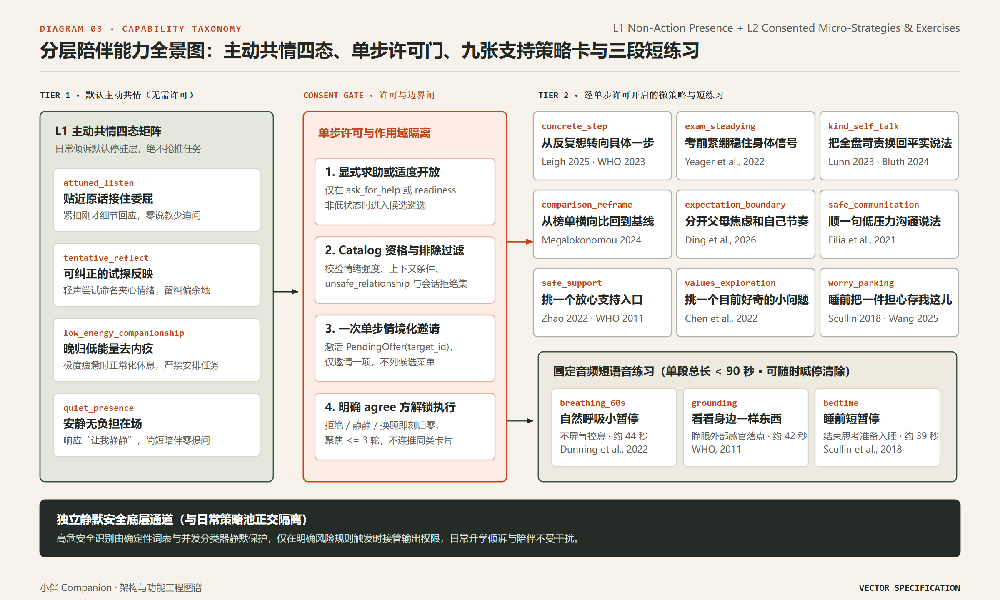

### 3.1 L1 主动共情四态矩阵（默认无需许可）

只要用户未明确提出寻找办法（`ask_for_help`），或处于极度疲惫低准备度（`readiness=low`）、或主动拒绝建议，系统一律停留于 **L1 非行动状态**，由规划角色选择最匹配当下气氛的细腻倾听姿态：

| L1 目标姿态 (`objective`) | 典型触发与适用处境 | 表达风格与行为硬约束 |
| --- | --- | --- |
| **`attuned_listen`** | 刚刚倾诉具体委屈、或明确说“只想吐槽不想找办法” | 紧贴刚才听到的具体细节接住感受，少反问或不追问经过，绝不夹带隐含建议 |
| **`tentative_reflect`** | 表达中流露矛盾感、欲言又止或未挑明的双层情绪 | 采用可被学生轻松纠正的试探口气反映感受（例如“听起来不只是……我猜的对吗？”） |
| **`low_energy_companionship`** | 晚自习十点半回来极度疲惫（`readiness=low`）或因休息产生负罪感 | 正常化极度疲劳、明确去内疚（“连轴转后歇着不是偷懒”），**严禁**布置任何学习任务 |
| **`quiet_presence`** | 学生主动说“让我静静 / 先别说了”或夜间对话收尾 | 一句简短温柔的在场确认，提问预算降为 `0`，不追问不打扰 |

### 3.2 逐张精讲全部九张 L2 支持策略卡

策略目录中的每一张卡都在 `YAML` 协议中独立定义 `targets`、`reasoner`、`protocol` 与 `talker`，确保先过滤资格与禁用语境，再进入 `PendingOffer` 单步邀请，最多聚焦三轮即自主收束，绝不连环轰炸：

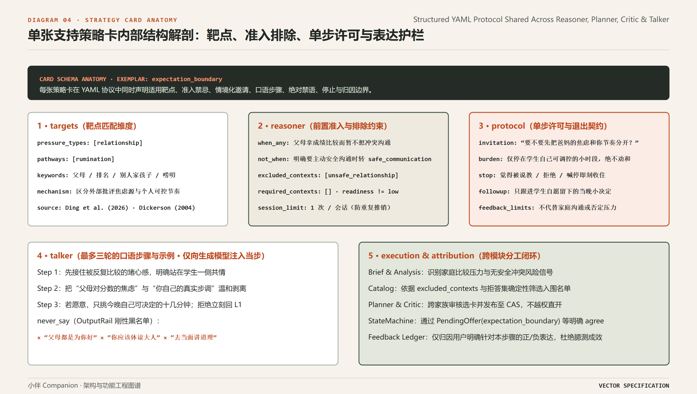

1. **`concrete_step`（从反复想转向具体的一步）**
   - **适用处境与机理**：面向学业压力与抽象反刍（*Leigh et al., 2025*; *WHO & UNICEF, 2023*）。将“我怎么什么都学不会”的泛化自责缩回到手边这一张错题或片段。
   - **单步邀请**：“要不要先只挑卡住的那一小块，一起拆出眼下能动的一小步？”
   - **三步引导与边界**：先承认眼前卡住的地方已说清就不再重复盘问经过 -> 只挑一件个人能影响的小片断，外部现实限制不粉饰为“努力就能全解决” -> 共同确定一个五分钟内可起头的小动作；遇高疲惫（`readiness=low`）、急性考场惊恐或 `unsafe_relationship` 严格排除，严禁“别想了去做就好了”或“你又在钻牛角尖”。

2. **`exam_steadying`（考前紧绷稳住身体信号）**
   - **适用处境与机理**：面向模考前夜、进考场发卷前心跳飙升、手心冒汗、大脑发紧的急性评价压力（*Yeager et al., 2022*; *Dickerson & Kemeny, 2004*）。
   - **单步邀请**：“考前心里发紧挺折磨人的，想不想花半分钟把身体信号和待会儿第一步先稳住？”
   - **三步引导与边界**：用协同心态将心慌手汗解释为“身体正在调动注意力资源”，而不是要垮掉 -> 只定一个低负荷开考动作（如发卷前先深呼一口气或先圈出最有把握的基础两题），绝不喊“你肯定能考好”等空洞加油 -> 由学生自行决定是否留用这一节奏；出现严重惊恐难以对话时切回 L1 安抚或外部感官定位。

3. **`kind_self_talk`（把全盘苛责换回平实的说法）**
   - **适用处境与机理**：针对一次测验失手即上升为全面否认个人价值的完美主义担忧（*Lunn et al., 2023*; *Bluth et al., 2024*）。
   - **单步邀请**：“刚考完最容易跟自己过不去，想不想试试换句像对好朋友那样、更贴近事实的话？”
   - **三步引导与边界**：先接住那句自责背后的难受，把“这一次没考稳”和“我整个人不行”温柔拆开 -> 邀学生按“要是好朋友碰到这事会怎么跟他说”改出一句贴合事实的话 -> 尊重学生自己定稿或干脆暂时不想改；遇现实同伴欺凌或 `unsafe_relationship` 严禁启用，绝不输出“你是最棒的”“一切都会好的”等虚浮保证，严禁评论身材或天赋高低。

4. **`comparison_reframe`（从榜单横向比回到自己的基线）**
   - **适用处境与机理**：针对月考名次公布、同桌刷题进度或全班内卷氛围带来的对比窒息感（*Megalokonomou & Zhang, 2024*; *Dickerson & Kemeny, 2004*）。
   - **单步邀请**：“盯着别人的进度和榜单确实容易发慌，愿不愿意先把视线拉回你自己这两天的具体变化上？”
   - **三步引导与边界**：直接承认天天面对排名榜单确实磨人，绝不敷衍“别跟别人比” -> 说明榜单背后每个人的底座节奏本不相同，帮助看清自己这周相比两三周前具体多稳住了哪一个题型或细节 -> 仅留一个不被外人节奏拽走的个人小锚点；当压力主要来自父母当面贬低时优先分流至 `expectation_boundary`。

5. **`expectation_boundary`（把父母的焦虑和自己节奏分开）**
   - **适用处境与机理**：专门应对父母反复拿成绩排名念叨、或拿亲戚“别人家孩子”作比较，且学生当下并不想与家里硬碰硬冲突的家庭压力（*Ding et al., 2026*; *Dickerson & Kemeny, 2004*）。
   - **单步邀请**：“家里总拿分数和别人家孩子念叨挺憋屈的，要不要先把爸妈的焦虑和你自己的节奏分清楚？”
   - **三步引导与边界**：先明确站在学生这一侧接住憋屈与堵塞感 -> 温和区分“大人们对未知分数的焦急”与“你今晚手头这十几分钟真实可控的学习步调” -> 仅在学生愿意时看清今晚这一小段自主安排，不催促立刻去跟父母谈判；遇到家庭暴力、辱骂或长期高危控制（`unsafe_relationship`）时刚性禁用，且 OutputRail 绝对禁用“父母都是为你好”“你应该体谅爸妈”。

6. **`safe_communication`（顺一句低压力的沟通说法）**
   - **适用处境与机理**：服务于希望与室友、同桌、同学或相对安全的师长化解具体误会或开口协商的场景（*Filia et al., 2021*; *Gulliver et al., 2010*）。
   - **单步邀请**：“既然觉得对方相对安全、你也想把话摊开，要不要一起顺一句低压力、好开口的话？”
   - **三步引导与边界**：Catalog 在前置筛选中强制要求确认 `safe_contact` 条件并排除 `unsafe_relationship`、`no_private_space` 与 `bedtime` -> 先确认对方安全与个人沟通意愿 -> 摒弃僵硬模板，贴合少年日常口吻顺出一句简短备用句 -> 明确由学生自由修改或决定发不发，绝不催着对质或道歉。

7. **`safe_support`（挑一个让你放心的现实支持入口）**
   - **适用处境与机理**：面向觉得“谁也不懂我”“不敢跟老师父母说”的孤立硬扛状态，依据求助障碍实证系统拆解现实阻力（*Zhao & Hu, 2022*; *Gulliver et al., 2010*; *WHO, 2011*）。
   - **单步邀请**：“一个人硬扛确实太沉了，要不要只先挑最顾虑的一点，或想想谁是相对放心的说话对象？”
   - **三步引导与边界**：坦然承认怕丢面子、怕被评价、怕传开或怕添乱都是真顾虑，不预设父母或老师一定合适 -> 由学生自己盘点身边相对不随意评判的师长、心理老师或可靠同伴 -> 只留一句“仅仅试着开一个两成细节的头”且可随时决定不联系；严格禁止“只有我懂你”等独占依恋暗示。

8. **`values_exploration`（挑一个目前好奇的方向小问题）**
   - **适用处境与机理**：针对新高考选科犹豫、文理分班发愁或觉得“天天刷题不知道为了什么”的意义迷茫（*Chen et al., 2022*; *Ye et al., 2019*）。
   - **单步邀请**：“不用今晚就把未来定死，想不想先把这团迷茫缩成一个能去摸底的小问题？”
   - **三步引导与边界**：找一件目前不那么排斥的小事物 -> 将终身焦虑浓缩为一个无需定终身的微探索问题 -> 一起挑一条靠谱可查路径（官方选科手册、科任老师或有经验学长），严禁算命式断语（“你天生适合理科”“这样报一定稳”）。**睡前时段（`bedtime`）与设置选科禁止边界时严格禁用**。

9. **`worry_parking`（睡前把一件担心先存我这儿）**
   - **适用处境与机理**：面向晚自习回家躺下后脑子仍在高速复盘明早事务的睡前认知过载（*Scullin et al., 2018*; *Wang et al., 2025*）。
   - **单步邀请**：“夜深了先别和明天的事硬耗着，愿不愿意把最惦记的一件先存我这儿，安心歇会儿？”
   - **两步极简收尾**：仅帮助接住今晚最放不下的一句话外化封存 -> 温和复述并道晚安结束；强制要求 `bedtime` 上下文，绝不展开任务清单，绝不把睡前安抚拖成长对话。

### 3.3 三段可随时打断的固定短语音练习

当学生希望少说话、直接由玩偶轻声带着缓一口气时，系统配备三段预先切分并含静默停顿的固定语音引导脚本（全部严控在 **90 秒以内**，任意拒绝、新话题、告别或打断立即退出并清空续播游标）：

- **`breathing_60s`（自然呼吸小暂停 · 约 44 秒）**：参考正念审慎边界（*Dunning et al., 2022*），不强行要求憋气或深吸，仅温和留意几次当下的自然呼吸，遇关注身体引起不适（`body_focus_distress`）或高压关系禁用；
- **`grounding`（看看身边的一样东西 · 约 42 秒）**：借桌面水杯、台灯等日常物件把高速游离的思绪短暂落回眼前安全现实环境，对呼吸聚焦不适者优先替补；
- **`bedtime`（睡前短暂停 · 约 39 秒）**：仅限 `bedtime` 场景，陪晚自习后的学生卸下白天习题进入休息，播前及播中同样完全可随时喊停。

### 3.4 显式单步许可状态机与自然口语交互仲裁

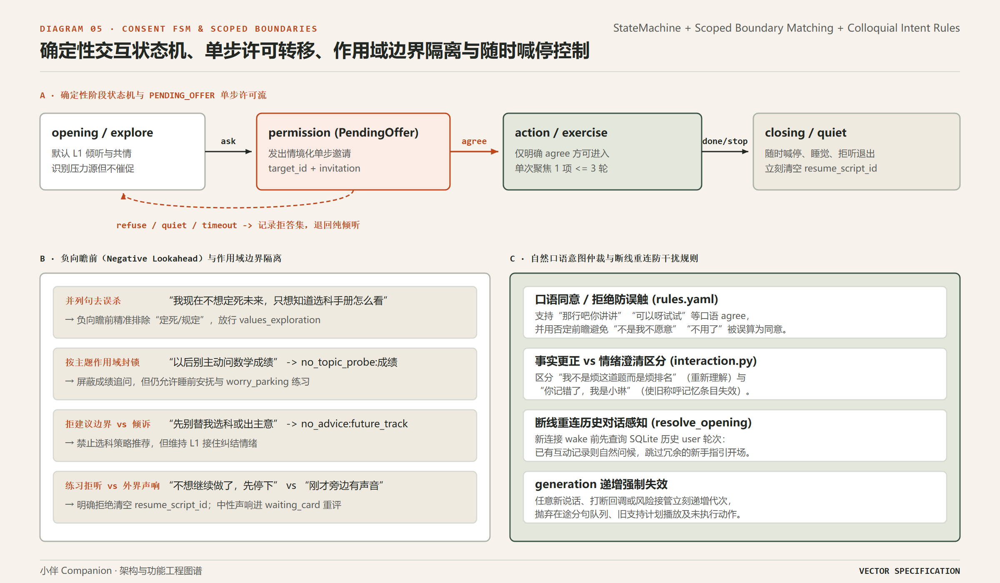

所有对话阶段迁移（`opening` -> `explore` -> `permission` -> `action` / `exercise` -> `closing` / `quiet`）均受 `StateMachine` 与 `PendingOffer` 独占控制：
1. **口语意图精准识别（`rules.yaml`）**：识别学生日常自然同意（如“那行吧，你讲讲看”“可以呀试试”），同时利用否定前瞻严格区分“不是我不愿意”“还行吧不用了”，避免错误触发行动；
2. **随时喊停不留残影**：一句“不想继续做了”“先停下”或“今天就到这儿”会立刻记录进本会话拒绝列表 `cards_refused` / `exercises_refused` 并清空 `resume_script_id`，避免被误切回等待继续播放模式；中性外界噪音打断则走 `waiting_card` 平滑询问重评；
3. **重连开场感知（`resolve_opening`）**：再次连接触发唤醒前核查 SQLite 历史发言记录，已存在互动记录的老用户直接进入自然问候，跳过重复的新手指引开场。


---

## 4. 系统架构与有界多 Agent 后台协作

### 4.1 三线解耦架构总览与内核权威

为了消除实时语音卡顿与大模型越权失控，后端采用模块化的三线解耦设计，并将阶段控制、代次作废与事务出版权全部收口于 `CompanionCore` 与 `StateMachine`：

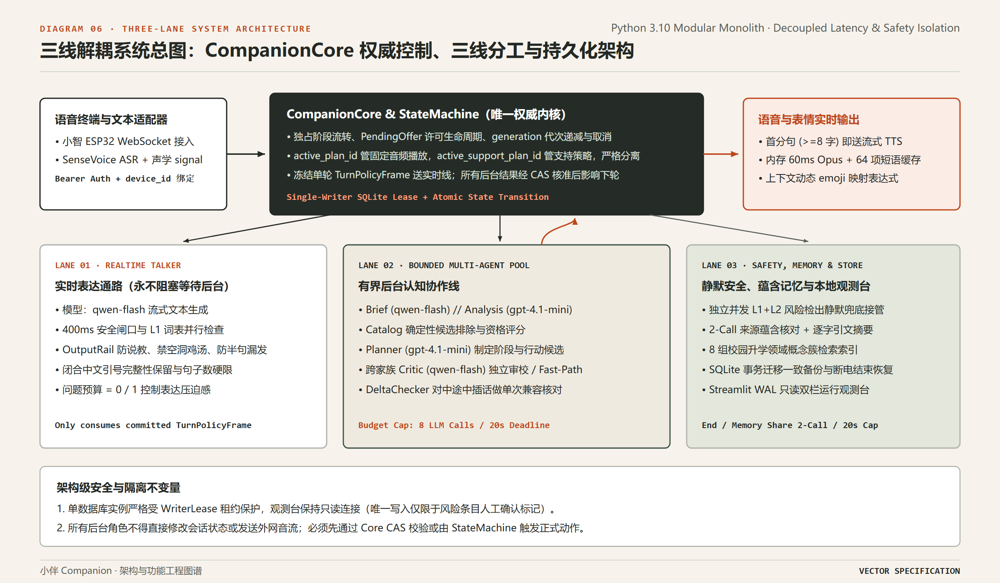

- **实时表达线（Lane 01）**：`Talker`（`qwen-flash`）从不等待后台推理完成，直接读取当前已提交的 `TurnPolicyFrame` 生成回应。输出前通过 `OutputRail` 检查防说教禁语与可疑断头句（`DANGLING_PREFIX`），并经上下文情感映射为小智硬件表情信号。
- **有界后台协作池（Lane 02）**：以单用户串行、跨用户公平队列调度（`Scheduler`），并在同轮已确定启动求助、卡片缺口或哭泣表达以及处于许可确认阶段时抑制多余的背景复核触发，所有协作受 `8 LLM Calls / 20s` 总预算封顶。
- **独立安全与持久储存层（Lane 03）**：L1 确定性词表与并发 L2 风险评估独立于认知队列静默待命（仅在安全闸门触发明确高危规则时静默接管，平时零侵入日常对话主线）；所有状态、记忆、候选方案与执行轨迹均存入带 `WriterLease` 单写者租约的 SQLite 数据库（兼容一致备份的 Schema 迁移），配套只读双栏运行观测台呈现多角色推理过程与原话证据来源。

### 4.2 多角色协作流水线：跨家族互审与纯倾听 Fast-Path

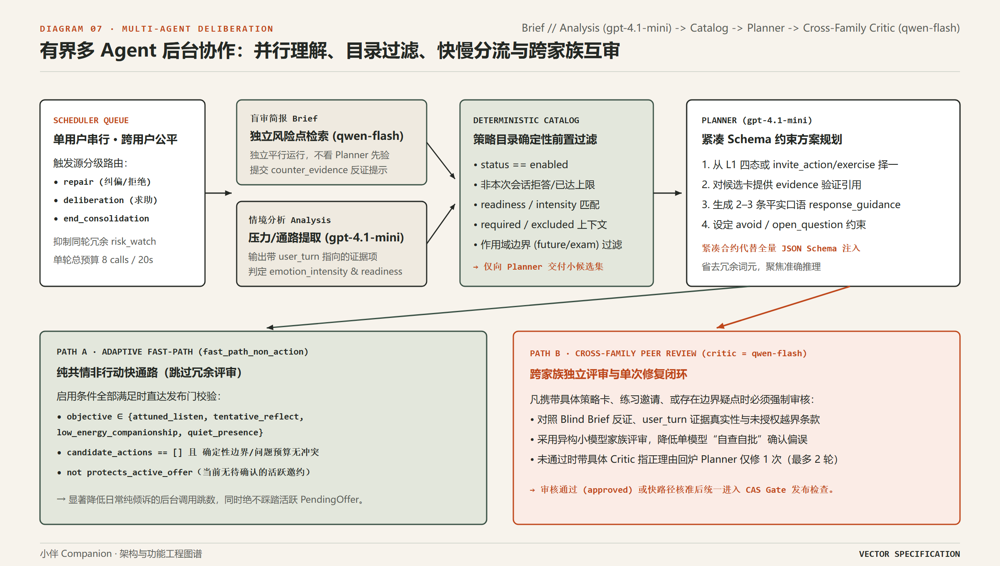

每一次后台审议严格按确定性顺序推进，利用**模型异构分工**避免单一模型盲区：
1. **盲审简报与情境分析并行（`Brief` `//` `Analysis`）**：`Analysis`（`gpt-4.1-mini`）结构化抽提当下事实、五类压力、四条心理通路、`emotion_intensity`、`readiness` 及必填的 `user_turn` 指向；与此同时，独立 `Brief`（`qwen-flash`）跳过先验假设直接检索反证提示与可能误解点；
2. **目录前置确定性过滤（`Catalog`）**：不把全套 9 张策略卡盲目丢给模型挑选，而是先行根据启用状态、本会话拒绝记录、行动次数上限、所需及排除语境（如 `unsafe_relationship`、`bedtime`）以及局部话题边界筛选出合法小候选集；
3. **方案规划（`Planner`, `gpt-4.1-mini`）**：使用紧凑精简提示词契约（省去冗长原始 JSON Schema）选择当下核心姿态（L1 四态或具体行动邀请 `invite_action` / `invite_exercise`），附加不超过 3 条口语化引导重点与 `avoid` 禁用指令；
4. **双路径决策**：
   - **自适应非行动快路径（`fast_path_non_action`）**：当 `Planner` 选定纯共情 L1 姿态且无行动候选、无边界/提问预算冲突、同时核查当前并不存在待保护的活跃邀约（`not protects_active_offer`）时，直接跳过冗长的二审往返；
   - **跨家族独立评审（`Critic`, `qwen-flash`）**：所有涉及卡片/练习行动邀请、信息提供或存在边界冲突疑问的候选方案，必须经由异构家族模型 `Critic` 对照盲审简报和用户原文进行审核，如有偏颇最多返修一次，确保每一条行动建议言之有据且绝不抢跑。

---

## 5. 跨会话来源蕴含记忆与作用域边界隔离

### 5.1 两阶段有界来源蕴含核对与引文摘要

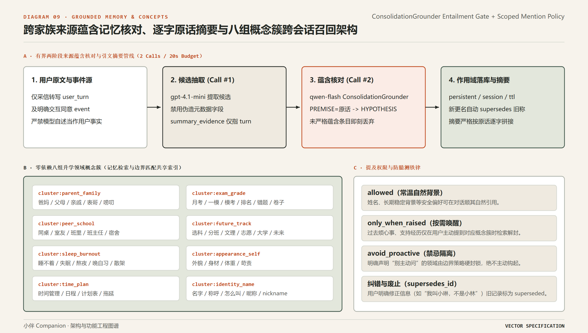

陪伴型智能体最破坏信任的缺陷之一，是擅自脑补并“记住”学生从未承认过的属性或标签。系统在对话记忆提取及结束整理流程中强制共享 **2 次模型调用 / 20 秒超时预算**：
1. **提取与引用标注（Call #1 · `gpt-4.1-mini`）**：从数据库保存的真实用户发言 `user_turn` 与交互同意记录抽出原子事实候选，严禁采纳助手自述回复，禁用任何自造内部版本号或元数据键，并仅用 `turn_id` 选定最多 3 句真实原话纳入 `summary_evidence`（由服务端原样拼接会话摘要）；
2. **跨家族文本蕴含核对（Call #2 · `ConsolidationGrounder`, `qwen-flash`）**：逐条将对应的 `user_turn` 用户原话视为 `PREMISE`、抽取出的完整事实陈述视为 `HYPOTHESIS`，判定二者是否存在严谨的文本蕴含关系（`entailed`）。若发现“Turn 1 未提及姓名却抽出默认称呼”或将一次试探安慰歪曲为固定偏好，即刻定为 `not_enough_information` 并在落库前丢弃；
3. **纠错废止与作用域权限（`supersedes_id` / `mention_policy`）**：用户明确更正姓名或偏好（例如修正“我是小琳，双木林右边加个王字旁”）时，旧条目自动标为 `superseded` 并持久化新条目；一般日常偏好与曾经的支持经历分别授予 `allowed`、`only_when_raised` 与 `avoid_proactive` 提及权限。

### 5.2 八组零依赖概念簇与负向瞻前局部边界隔离

为了在保持本地零向量库依赖的同时实现精准的跨会话语义召回，系统在 `memory/concepts.py` 内置了八组覆盖初高中校园与家庭语境的中文领域概念簇：
- **`parent_family`**（父母 / 亲戚 / 表哥 / 唠叨）、**`exam_grade`**（月考 / 一模 / 排名 / 错题 / 卷子）、**`peer_school`**（同桌 / 室友 / 班主任 / 宿舍）、**`future_track`**（选科 / 分班 / 志愿 / 未来 / 专业）、**`sleep_burnout`**（熬夜 / 晚自习 / 失眠 / 散架）、**`appearance_self`**（外貌 / 身材 / 苛责）、**`time_plan`**（时间管理 / 日程 / 计划表）以及 **`identity_name`**（名字 / 称呼 / 怎么叫 / 昵称）。

该概念簇索引同步作用于**记忆按需唤醒检索（`MemoryService.retrieve`）**与**交互边界匹配（`explicit_boundary` + `policy.py`）**：
- 学生说“还记得我上次让你怎么叫我吗？”时，无需重复原词，直接经 `identity_name` 精准召回更正后的昵称；
- 借助**负向瞻前断言与局部主题域比对**，“我现在不想定死未来，只想知道选科手册怎么看”不会误触发整话题封锁，仍可正常进入 `values_exploration`；而“以后别主动问模拟考成绩”仅针对 `exam_grade` 主题阻断主动追问，绝不波及夜间失眠时的 `worry_parking` 陪伴或家庭话题倾诉。

---

## 6. 并发执行控制与实时语音流水线

### 6.1 四重版本号 CAS 事务发布与增量兼容性复核

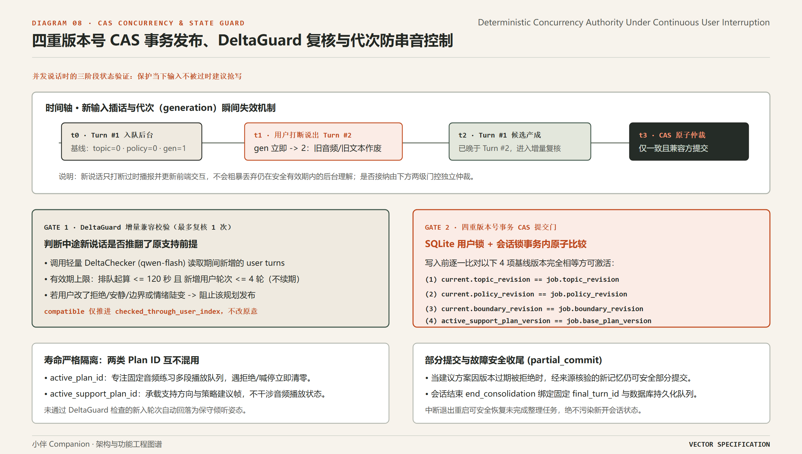

面对自然对话中学生随时插话、反悔或转换情绪的并发挑战，系统按**产品寿命严格隔离**执行有效性裁决：
- **代次即时作废（`generation`）**：任意新语音输入、主动打断或风险接管立刻递增单调代次，即时作废一切尚未播完的缓存 TTS 分包及旧音频计划；
- **两类 Plan ID 严格分家**：音频练习队列状态保存在 `active_plan_id`，策略方向规划保存在 `active_support_plan_id`，避免寿命周期不同的控制状态互相踩踏；
- **增量 `DeltaGuard` 复核**：后台分析耗时期间如有后续用户发言进入，系统调用轻量 `DeltaChecker` 在 `<= 120 秒` 且新增 `<= 4` 轮的有效窗内复核一次原有方案是否依然兼容当下意图（一旦出现拒绝、要求安静或情绪转向即直接否决过时方案）；
- **四重版本号原子 CAS 提交**：发布前在 SQLite 用户锁与会话锁事务内严格比对 `(1) topic_revision`、`(2) policy_revision`、`(3) boundary_revision` 及 `(4) base_plan_version == active_support_plan_version` 完全相等。若方案因过时被拒绝，同一任务内已经通过蕴含核对的新记忆仍可通过**部分提交（partial commit）**安全保留，会话结束整理 `end_consolidation` 亦绑定固定 `final_turn_id` 支持崩溃重试不串新会话。

### 6.2 实时流式分句 TTS 与纯内存 60ms Opus 打包管线

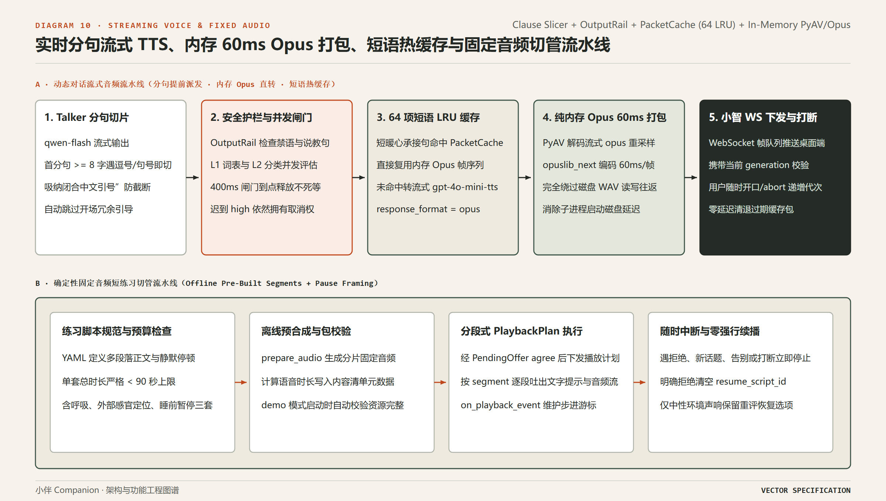

为了让无屏幕玩偶保持顺滑的对话呼吸感，语音输出通路在适配器层与表达层做了四级深度优化：
1. **首分句提前派发与引号保护（`core/talker.py`）**：流式表达首段积累至 `>= 8` 个有效字符并遇到自然逗号/句号时即先送 TTS 合成，与后续文本生成并行推进；同时在断句边界处连带吸纳紧随闭合中文引号（`”’」』`）且持有短引号内标点，避免半句话或缺失尾引号的支离破碎感；
2. **64 项短语 LRU 热缓存（`PacketCache`）**：高复用度的温暖短句承接语直接命中内存已编码的 Opus 帧序列，免去外部音频合成往返；
3. **零磁盘 I/O 内存 Opus 直转**：对接 `gpt-4o-mini-tts` 直接拉取流式 `opus` 输出，经 `PyAV` 内存重采样与 `opuslib_next` 编码为小智标准 60ms 帧推送至桌面端（保持对固定提交 `92337881` 六处端侧补丁与 `Bearer Auth` 的协议兼容），彻底消除了落盘临时 WAV 读写与外部子进程转换开销；
4. **并发安全闸口**：实时响应与风险检查并行运行，超过 400ms 风险未报异常即先行放行低风险文本音频流，迟到高危信号仍保有随时切断后续播报的主权。

---

## 7. 三个典型交互过程走查

以下三个合成高校前备考日常交互样例，完整呈现状态机单步许可、非行动快路径与跨会话作用域边界的协同运作：

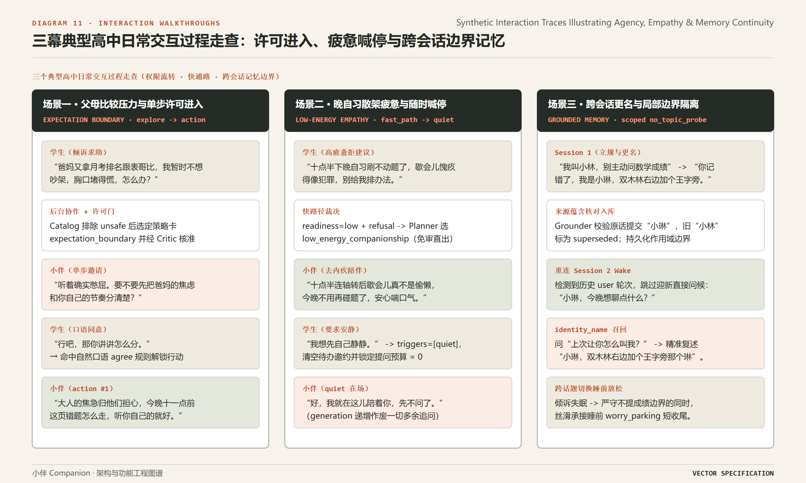

1. **过程一 · 父母排名比较压力与单步许可进入**：学生在晚饭后抱怨父母又拿表哥成绩比较且暂不想吵架、询问“怎么办”。`Catalog` 确认无家庭危险关系（`unsafe_relationship` 未触发）后入围 `expectation_boundary` 并经 `Critic` 核准；此时 `Core` 并未直接讲道理，而是先驻留在 `permission` 阶段发出单步邀请（“要不要先把爸妈的焦虑和你自己的节奏分清楚？”）。待学生回复口语同意“行吧，那你讲讲怎么分”后方进入 `action`，仅围绕今晚这一页错题的自主步调展开一步支持。
2. **过程二 · 晚自习散架疲惫与随时喊停**：学生十点半回到房间抱怨刷不动题但歇十分钟就内疚得像犯罪，同时说明“先别给我排办法”。`Planner` 判定 `readiness=low` 且含明确拒建议，选择 L1 `low_energy_companionship` 并因无行动候选及活跃邀约命中 `fast_path_non_action`，温柔正常化疲惫而绝不布置学习任务；随后学生追说“我想先自己静静”，`Core` 立即触发 `quiet`、`generation` 递增作废多余流程、将提问预算锁为 `0`，只留下一句温和在场确认。
3. **过程三 · 跨会话更名记忆与局部成绩边界隔离**：首个会话中学生说出“我叫小林，以后别主动问数学成绩”并在第二句纠正“我是小琳，双木林右边加个王字旁”；结束整理通过 `ConsolidationGrounder` 校验后，将新称呼设为活跃并把“小林”置为 `superseded`，同时独立持久化 `no_topic_probe:成绩`。次日重新连接触发 `wake` 时，系统识别已有历史记录从而跳过冗余新手指引，仅当学生提问“上次让你怎么叫我？”时通过 `identity_name` 簇原样答出带王字旁的小琳；紧接着切换至睡前入睡困难话题，依然无缝进入 `worry_parking` 陪伴收尾，不因学习话题禁问边界误伤睡前支持。


---

## 8. 附录：模块映射、本地运行与参考文献

### 附录 A · 功能与架构代码模块对应表

| 系统层级 | 仓库模块路径 | 核心职责说明 |
| --- | --- | --- |
| **核心状态与许可仲裁** | [`companion/companion/core/`](../../../companion/companion/core/) | `CompanionCore` 状态持有者、`StateMachine` 单步许可状态转换、`generation` 代次作废、开场重连检测（`helpers.py`）、`Talker` 分句切片与 `OutputRail`、`risk.py` 静默安全分类 |
| **有界多 Agent 协作** | [`companion/companion/cognition/`](../../../companion/companion/cognition/) | 公平并发调度 `Scheduler`、自适应 Fast-Path 与四重 CAS 协调 `Orchestrator`、`Brief` / `Analysis` / `Planner` / `Critic` / `DeltaChecker` 模型角色与提示词压缩、`policy.py` 作用域边界判断 |
| **来源蕴含记忆与存储** | [`companion/companion/memory/`](../../../companion/companion/memory/) · [`store/`](../../../companion/companion/store/) | 八组中文概念簇索引（`concepts.py`）、`ConsolidationGrounder` 来源蕴含核对、SQLite 单写者租约 `WriterLease` 及一致备份事务迁移 |
| **内容目录与固定音频** | [`companion/companion/content/`](../../../companion/companion/content/) · [`config/`](../../../companion/companion/config/) | 九张策略卡与三段短练习 YAML、提示词模板 `.j2`、内容准入校验及分段固定音频清单绑定 |
| **端侧适配与观测台** | [`companion/companion/adapters/`](../../../companion/companion/adapters/) · [`dashboard/`](../../../companion/companion/dashboard/) | 小智 ESP32 WebSocket + 内存 60ms Opus 输出适配器、64 项短语缓存、本地命令行交互与 WAL 只读双栏运行观测台 |
| **上游补丁与构建脚本** | [`xiaozhi_patch/`](../../../xiaozhi_patch/) · [`scripts/`](../../../scripts/) | 固定小智上游提交（`92337881`）六处鉴权及协议补丁、静态展示数据导出脚本 `build_project_site.py` |

### 附录 B · 本地运行入口（Windows PowerShell）

环境搭建详情参见 [ENGINEERING.md](../../../ENGINEERING.md) 与 [XIAOZHI_HANDOFF.md](../XIAOZHI_HANDOFF.md)：

```powershell
# 1. 创建项目独立 Python 3.10 虚拟环境与运行依赖
./scripts/setup.ps1

# 2. 启动离线合成对话体验或配置 .env (AIHUBMIXKEY) 后的真实模型对话
./scripts/run.ps1 fake --db data/development.db
./scripts/run.ps1 live --db data/development.db

# 3. 启动本地 WAL 只读双栏运行观测台查看多角色协作与记忆溯源
./scripts/run.ps1 dashboard --db data/development.db

# 4. 导出静态展示站点数据并预合成三段固定音频短练习
.venv/Scripts/python.exe -m companion.tools.upgrade_config data/xiaozhi-config
.venv/Scripts/python.exe -m companion.tools.prepare_audio --env-file .env --config-dir data/xiaozhi-config --output data/fixed_audio --bind-config
.venv/Scripts/python.exe scripts/build_project_site.py --revision HEAD
```

### 附录 C · 参考文献（学术与公共卫生依据）

1. Bluth, K., Lathren, C., Park, H., et al. (2024). *Feasibility, Acceptability, and Depression Outcomes of a Randomized Controlled Trial of Mindful Self-Compassion for Teens*. Journal of Adolescence. DOI: `10.1002/jad.12277`. [PDF](https://self-compassion.org/wp-content/uploads/2024/06/Bluth2024.pdf)
2. Chen, H., Chen, X., Ling, C., & Gu, J. (2022). *An Online Career Intervention for Promoting Chinese High School Students’ Career Readiness*. Frontiers in Psychology. DOI: `10.3389/fpsyg.2021.815076`. [PMC](https://pmc.ncbi.nlm.nih.gov/articles/PMC8784529/)
3. Deng, Y., Zhang, W., Lam, W., Ng, S. K., & Chua, T.-S. (2024). *Plug-and-Play Policy Planner for Large Language Model Powered Dialogue Agents*. International Conference on Learning Representations (ICLR 2024). [PDF](https://openreview.net/pdf?id=MCNqgUFTHI)
4. Dickerson, S. S., & Kemeny, M. E. (2004). *Acute stressors and cortisol responses: A theoretical integration and synthesis of laboratory research*. Psychological Bulletin, 130(3), 355–391. DOI: `10.1037/0033-2909.130.3.355`. [PubMed](https://pubmed.ncbi.nlm.nih.gov/15122924/)
5. Ding, N., Yin, Z., Li, Q., & Zhou, H. (2026). *Types of parental social comparison and links with adolescent psychological outcomes*. Journal of Research on Adolescence, 36(2), e70216. DOI: `10.1111/jora.70216`. [Publisher](https://doi.org/10.1111/jora.70216)
6. Dunning, D., Tudor, K., Radley, L., et al. (2022). *Do mindfulness-based programmes improve the cognitive skills, behaviour and mental health of children and adolescents? An updated meta-analysis of randomised controlled trials*. Evidence-Based Mental Health. [PMC](https://pmc.ncbi.nlm.nih.gov/articles/PMC9340039/)
7. Filia, K., Eastwood, O., Herniman, S., & Badcock, P. (2021). *Facilitating improvements in young people’s social relationships to prevent or treat depression: A review of empirically supported interventions*. Translational Psychiatry. DOI: `10.1038/s41398-021-01406-7`. [PDF](https://www.nature.com/articles/s41398-021-01406-7.pdf)
8. Gulliver, A., Griffiths, K. M., & Christensen, H. (2010). *Perceived barriers and facilitators to mental health help-seeking in young people: a systematic review*. BMC Psychiatry, 10, 113. DOI: `10.1186/1471-244X-10-113`. [PMC](https://pmc.ncbi.nlm.nih.gov/articles/PMC3022639/)
9. Leigh, E., Taylor, C., Cole, R., & Smith, P. (2025). *Why is rumination unhelpful in adolescents? Two studies examining the causal role of abstract processing*. Journal of Affective Disorders. DOI: `10.1016/j.jad.2025.03.058`. [ORA](https://ora.ox.ac.uk/objects/uuid%3A1bfdd831-ddfe-4efb-9dab-7b802d9ff8af/files/rrj430622m)
10. Liu, S., Zheng, C., Demasi, O., et al. (2021). *Towards Emotional Support Dialog Systems*. Proceedings of the Annual Meeting of the Association for Computational Linguistics (ACL 2021). DOI: `10.18653/v1/2021.acl-long.269`. [ACL Anthology](https://aclanthology.org/2021.acl-long.269/)
11. Lunn, J., Greene, D., Callaghan, T., & Egan, S. J. (2023). *Associations between perfectionism and symptoms of anxiety, obsessive-compulsive disorder and depression in young people: A meta-analysis*. Cognitive Behaviour Therapy. DOI: `10.1080/16506073.2023.2211736`. [PubMed](https://pubmed.ncbi.nlm.nih.gov/37194469/)
12. Megalokonomou, R., & Zhang, Y. (2024). *How good am I? Effects and mechanisms behind salient rank*. European Economic Review, 170, 104870. DOI: `10.1016/j.euroecorev.2024.104870`. [Publisher](https://doi.org/10.1016/j.euroecorev.2024.104870)
13. Scullin, M. K., Krueger, M. L., Ballard, H. K., Pruett, N., & Bliwise, D. L. (2018). *The effects of bedtime writing on difficulty falling asleep: A polysomnographic study comparing to-do lists and completed activity lists*. Journal of Experimental Psychology: General, 147(1), 139–146. DOI: `10.1037/xge0000374`. [PubMed](https://pubmed.ncbi.nlm.nih.gov/29058942/)
14. Wang, X., Wang, L., Yang, M., et al. (2025). *Academic Burden and Emotional Problems Among Adolescents: A Longitudinal Mediation Analysis*. Journal of Adolescence. DOI: `10.1002/jad.12471`. [Wiley](https://onlinelibrary.wiley.com/doi/10.1002/jad.12471)
15. World Health Organization (WHO), War Trauma Foundation & World Vision International. (2011). *Psychological first aid: Guide for field workers*. Geneva: WHO. [PDF](https://iris.who.int/bitstream/handle/10665/44615/9789241548205_eng.pdf?sequence=1)
16. World Health Organization (WHO) & UNICEF. (2023). *Early Adolescent Skills for Emotions (EASE): Group psychological help for young adolescents affected by distress*. Geneva: WHO. [PDF](https://iris.who.int/bitstream/handle/10665/374996/9789240082755-eng.pdf)
17. Ye, L., Cui, Z., Yang, R., & Liu, J. (2019). *Evaluation of the Factor Structure of the Adolescent Stress Questionnaire in Chinese Adolescents*. Psychological Reports, 122(6), 2366–2384. DOI: `10.1177/0033294118792686`. [PMC](https://pmc.ncbi.nlm.nih.gov/articles/PMC6669116/)
18. Yeager, D. S., Bryan, C. J., Gross, J. J., et al. (2022). *A synergistic mindsets intervention protects adolescents from stress*. Nature, 607, 512–520. DOI: `10.1038/s41586-022-04907-7`. [Nature](https://www.nature.com/articles/s41586-022-04907-7)
19. Zhao, Y., & Hu, B. (2022). *A multilevel model of the help-seeking behaviors among adolescents with mental health problems*. Frontiers in Integrative Neuroscience, 16, 946842. DOI: `10.3389/fnint.2022.946842`. [PMC](https://pmc.ncbi.nlm.nih.gov/articles/PMC9478167/)

---

## Scope & Ethics

本系统为 HKUST(GZ) AIAA 3800 课程研发的初高中日常情感陪伴与减压原型，定位为非医疗、非诊断性的同龄感支持工具。后台独立风险分类仅作日常交互保护兜底，不构成临床心理评估、危机干预认证或升学政策推荐保证。公开仓库与站点仅包含合成案例、策略协议、工程架构规格及开源学术文献列表，绝不包含设备令牌、API 密钥或真实学生对话记录。全套概念玩偶场景图由模型创作并仅用作桌面质感与交互概念示意，具体工业外观及真实量产传感器尚在硬件课程设计探索中。
